# 4. APIs REST implementadas

> Borrador para el informe. Todo lo de esta sección sale del código (`controller/*RestController.java`,
> `NotificacionController.java`, `ApiErrorAdvice.java`, `SecurityConfig.java`) y de pruebas reales hechas el
> 10/11/2026 sobre una copia local con los datos demo (`skillbridge_db_v4.sql` + `datos_demo_rm_proyectos.sql`).
> Las capturas de Postman están en `capturas/` (tomadas el 10/11/2026).

SkillBridge AI es principalmente una aplicación web con vistas Thymeleaf. Las pantallas que necesitan
actualizarse sin recargar la página consumen una API REST propia que devuelve JSON:

- **Chat del proyecto** (PM y colaborador): la vista consulta los mensajes y envía nuevos con `fetch`.
- **Notificaciones** (todos los roles): la campana de la topbar lista las notificaciones y las marca como leídas
  (`static/js/notificaciones.js`).

## 4.1 Tabla resumen

| Módulo | Método | URL | Descripción | Rol | HTTP |
|---|---|---|---|---|---|
| Chat del PM | GET | `/pm/api/chat/mensajes?proyectoId={id}` | Lista los mensajes del chat de un proyecto del PM. Si el chat no existe, lo crea vacío | Project Manager | 200, 400, 401, 403 |
| Chat del PM | POST | `/pm/api/chat/enviar` | Envía un mensaje al chat de un proyecto del PM | Project Manager | 200, 400, 401, 403 |
| Chat del colaborador | GET | `/colaborador/api/chat/mensajes?proyectoId={id}` | Lista los mensajes del chat de un proyecto donde el colaborador tiene una asignación activa | Colaborador | 200, 400, 401, 403 |
| Chat del colaborador | POST | `/colaborador/api/chat/enviar` | Envía un mensaje al chat del proyecto (el PM debe haberlo iniciado) | Colaborador | 200, 400, 401, 403, 409 |
| Notificaciones | GET | `/api/notificaciones` | Lista las 20 notificaciones más recientes del usuario con sesión | Cualquier rol autenticado | 200, 401 |
| Notificaciones | POST | `/api/notificaciones/{id}/leer` | Marca como leída una notificación del usuario | Cualquier rol autenticado | 204, 400, 401, 403 |
| Notificaciones | POST | `/api/notificaciones/leer-todas` | Marca como leídas todas las notificaciones del usuario | Cualquier rol autenticado | 204, 401, 403 |

No hay endpoints `PUT` ni `DELETE`: el chat no permite editar ni borrar mensajes y las notificaciones solo
cambian de estado (leída/no leída). Todas las altas, ediciones y bajas del resto del sistema se hacen con
formularios Thymeleaf (`@Controller`), no por API.

**Códigos HTTP usados**

| Código | Cuándo |
|---|---|
| 200 OK | Consulta o envío correcto con respuesta JSON |
| 204 No Content | Notificación(es) marcada(s) como leída(s); sin body |
| 400 Bad Request | Dato inválido o faltante, o recurso que no existe o no le pertenece al usuario. Body `{"error": "..."}` |
| 401 Unauthorized | Petición sin sesión iniciada; sin body |
| 403 Forbidden | Falta el token CSRF en un POST, o el rol no corresponde a la ruta |
| 409 Conflict | El colaborador escribe en un chat que el PM todavía no inició. Body `{"error": "..."}` |

## 4.2 Autenticación y seguridad

| Aspecto | Cómo funciona en el proyecto |
|---|---|
| Autenticación | Spring Security con formulario (`POST /login`, campos `username` y `password`). La API usa la **misma sesión** que las vistas; la sesión se guarda en MySQL con Spring Session JDBC (cookie `SESSION`). No hay tokens JWT ni API keys. |
| Sin sesión | Las rutas `/api/**`, `/pm/api/**` y `/colaborador/api/**` responden **401**; las vistas siguen redirigiendo a `/login` (`SecurityConfig`). |
| Autorización por rol | Por URL en `SecurityConfig`: `/pm/**` exige `PROJECT_MANAGER`, `/colaborador/**` exige `COLABORADOR`. `/api/notificaciones/**` exige solo sesión iniciada. Rol equivocado: **403**. |
| Autorización por dato | Los servicios comprueban la propiedad: el PM solo accede al chat de sus proyectos (`PmChatService`), el colaborador solo al de proyectos con asignación `ACTIVA` (`ColChatService`), y cada usuario solo marca sus propias notificaciones (`findByIdAndUsuario`). |
| CSRF | Activo. Todo `POST` debe enviar el token en la cabecera `X-CSRF-TOKEN`; las vistas lo leen de `<meta name="_csrf">` (`static/js/csrf.js`). Sin token: **403**. |
| Errores | `ApiErrorAdvice` (`@RestControllerAdvice` limitado a los tres controladores REST) convierte los errores de negocio en JSON `{"error": "mensaje"}` con su código HTTP. Los mensajes están escritos para el usuario y no exponen detalles técnicos. |
| Límite de peticiones | `LimiteSolicitudesFilter` limita las peticiones por IP y por minuto (429 si se excede). |
| CORS | No se configura: la API solo la consume el propio sitio (mismo origen). |
| Validación de entrada | En el servicio: proyecto obligatorio, mensaje no vacío, máximo 1000 caracteres y sin espacios al inicio ni al final (las mismas reglas en el chat del PM y del colaborador). |

## 4.3 Fichas de cada endpoint

Formato de la clase 9.2 ("Documentación listar/obtener Productos").

---

### Consumo API REST para listar los mensajes del chat (PM)

| URL | Method |
|---|---|
| `http://{servidor}:8080/pm/api/chat/mensajes?proyectoId={id}` | GET |

**Autenticación:** sesión iniciada con rol Project Manager.

**Argumentos de entrada:**

| Campo | Tipo de dato | Observaciones |
|---|---|---|
| proyectoId | entero | Obligatorio (query string). Debe ser un proyecto cuyo PM es el usuario con sesión |

**Argumentos de salida:**

Opción 1: Solicitud correcta
Http Status: HTTP 200 OK
Body:
```json
[
  {
    "id": 1,
    "autorNombre": "Pablo Morales",
    "autorIniciales": "PM",
    "contenido": "Hola equipo, reunion el lunes a las 10.",
    "hora": "15:45",
    "esPropio": true
  }
]
```
Si el proyecto todavía no tiene chat, se crea vacío y se devuelve `[]`.

Opción 2: Error en los parámetros de la solicitud
Http Status: HTTP 400 Bad Request
Body:
```json
{ "error": "No eres el PM de este proyecto." }
```

| Caso | `error` devuelto |
|---|---|
| Sin `proyectoId` | Falta el parámetro "proyectoId". |
| `proyectoId` no numérico | El valor del parámetro "proyectoId" no es válido. |
| Proyecto de otro PM | No eres el PM de este proyecto. |
| Proyecto inexistente | Proyecto no encontrado. |

Opción 3: Sin sesión
Http Status: HTTP 401 Unauthorized (sin body).

**Datos de salida:**

| Campo | Tipo de dato | Observaciones |
|---|---|---|
| id | entero | Id del mensaje |
| autorNombre | cadena | Nombre y apellido del autor |
| autorIniciales | cadena | Iniciales en mayúscula, para el avatar |
| contenido | cadena | Texto del mensaje |
| hora | cadena | Hora de envío en formato `HH:mm` |
| esPropio | booleano | true si el autor es el usuario que consulta |

**Ejemplos:** Solicitud correcta: 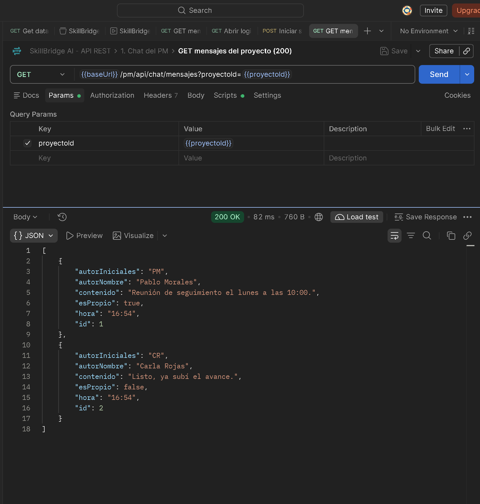 · Solicitud incorrecta: 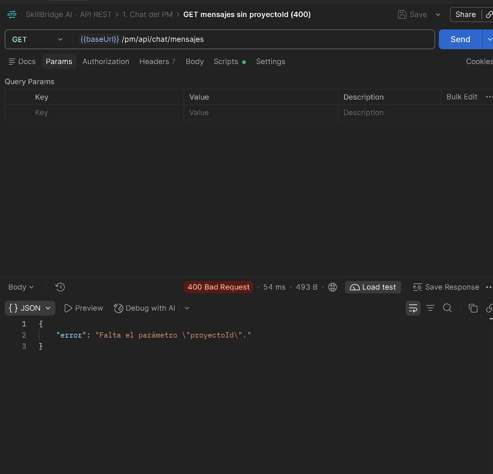

---

### Consumo API REST para enviar un mensaje al chat (PM)

| URL | Method |
|---|---|
| `http://{servidor}:8080/pm/api/chat/enviar` | POST |

**Autenticación:** sesión con rol Project Manager + cabecera `X-CSRF-TOKEN`.
**Formato de entrada:** `application/x-www-form-urlencoded`.

**Argumentos de entrada:**

| Campo | Tipo de dato | Observaciones |
|---|---|---|
| proyectoId | entero | Obligatorio. Proyecto del PM con sesión |
| contenido | cadena | Obligatorio, no puede estar vacío ni tener solo espacios. Máximo 1000 caracteres. Se guarda sin espacios al inicio y al final |

**Argumentos de salida:**

Opción 1: Solicitud correcta
Http Status: HTTP 200 OK
Body:
```json
{
  "id": 2,
  "autorNombre": "Pablo Morales",
  "autorIniciales": "PM",
  "contenido": "Revisión del avance",
  "hora": "15:45",
  "esPropio": true
}
```

Opción 2: Error en los parámetros de la solicitud
Http Status: HTTP 400 Bad Request
Body (el texto de `error` cambia según la regla que falla):
```json
{ "error": "El mensaje no puede estar vacío." }
```

| Caso | `error` devuelto |
|---|---|
| Sin `proyectoId` | Debes seleccionar un proyecto para enviar un mensaje. |
| `contenido` vacío o con espacios | El mensaje no puede estar vacío. |
| Más de 1000 caracteres | El mensaje no puede superar los 1000 caracteres. |
| Proyecto de otro PM | No eres el PM de este proyecto. |
| Proyecto inexistente | Proyecto no encontrado. |

Opción 3: Sin token CSRF
Http Status: HTTP 403 Forbidden
Body:
```json
{ "timestamp": "2026-11-10T20:44:51.936Z", "status": 403, "error": "Forbidden", "path": "/pm/api/chat/enviar" }
```

**Datos de salida:** iguales a los del listado (un solo objeto mensaje).

**Ejemplos:** Solicitud correcta: 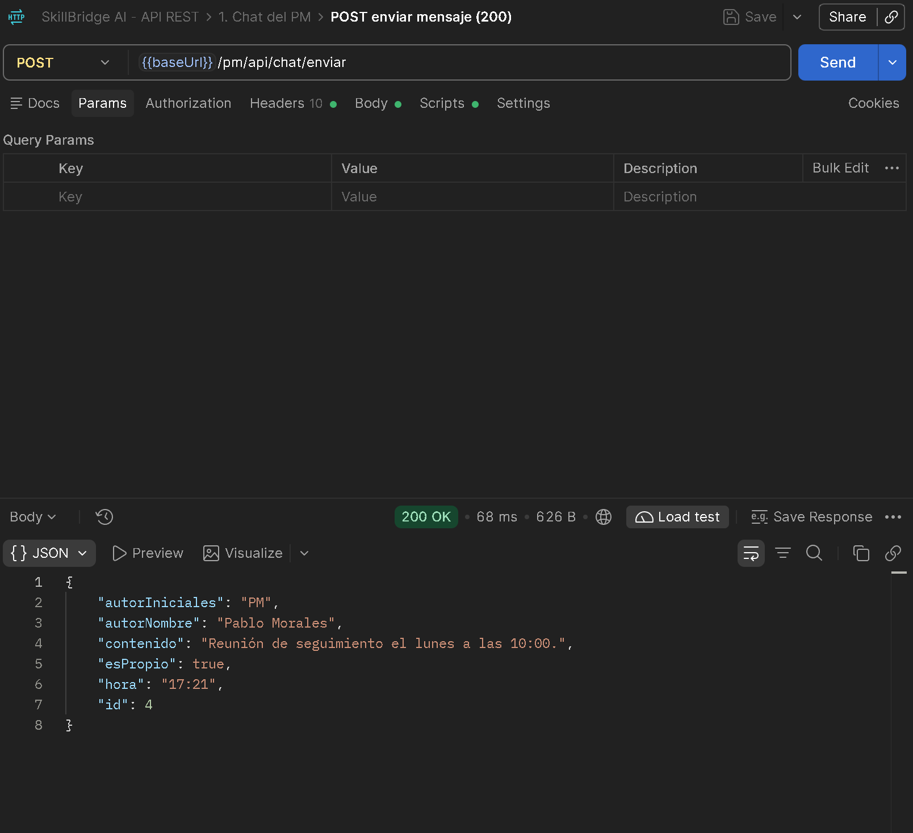 · Solicitud incorrecta: 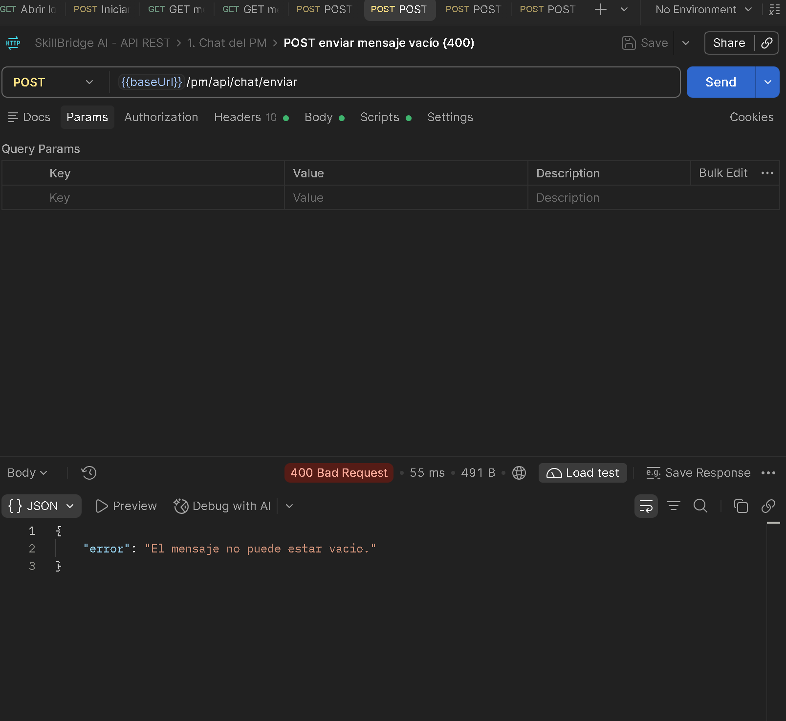

---

### Consumo API REST para listar los mensajes del chat (colaborador)

| URL | Method |
|---|---|
| `http://{servidor}:8080/colaborador/api/chat/mensajes?proyectoId={id}` | GET |

**Autenticación:** sesión con rol Colaborador.

**Argumentos de entrada:**

| Campo | Tipo de dato | Observaciones |
|---|---|---|
| proyectoId | entero | Obligatorio. El colaborador debe tener una asignación `ACTIVA` en ese proyecto |

**Argumentos de salida:**

Opción 1: Solicitud correcta
Http Status: HTTP 200 OK
Body:
```json
[
  { "id": 1, "autorNombre": "Pablo Morales", "autorIniciales": "PM", "contenido": "Hola equipo, reunion el lunes a las 10.", "hora": "15:45", "esPropio": false },
  { "id": 3, "autorNombre": "Carla Rojas", "autorIniciales": "CR", "contenido": "Listo, ya subi el avance", "hora": "15:45", "esPropio": true }
]
```
Si el PM aún no inició el chat, devuelve `[]` (a diferencia del PM, el colaborador no lo crea).

Opción 2: Error en los parámetros de la solicitud
Http Status: HTTP 400 Bad Request
Body:
```json
{ "error": "No eres un colaborador activo de este proyecto." }
```

| Caso | `error` devuelto |
|---|---|
| Sin `proyectoId` | Falta el parámetro "proyectoId". |
| `proyectoId` no numérico | El valor del parámetro "proyectoId" no es válido. |
| Proyecto sin asignación activa del colaborador | No eres un colaborador activo de este proyecto. |
| Proyecto inexistente | Proyecto no encontrado. |

Opción 3: Sin sesión: HTTP 401 Unauthorized. Con otro rol: HTTP 403 Forbidden.

**Datos de salida:** mismos campos que el chat del PM.

**Ejemplos:** Solicitud correcta: 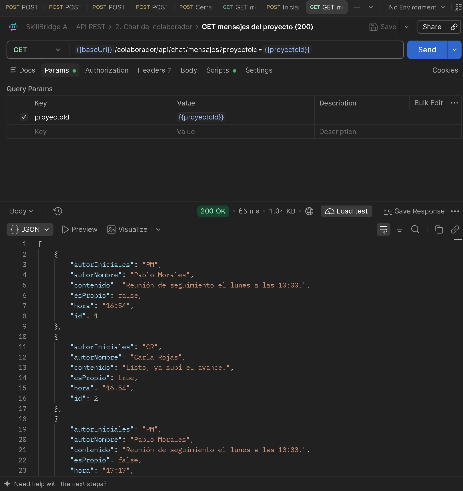 · Solicitud incorrecta (rol equivocado): 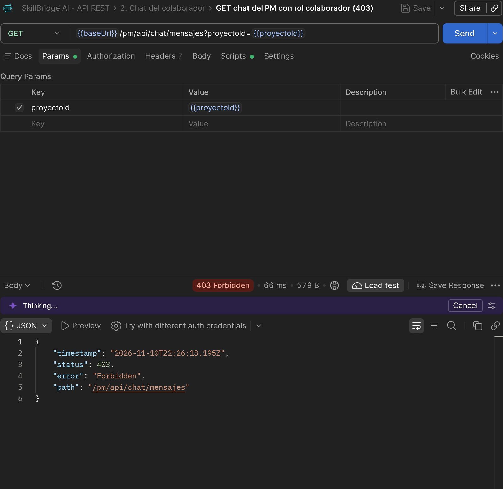

---

### Consumo API REST para enviar un mensaje al chat (colaborador)

| URL | Method |
|---|---|
| `http://{servidor}:8080/colaborador/api/chat/enviar` | POST |

**Autenticación:** sesión con rol Colaborador + cabecera `X-CSRF-TOKEN`.
**Formato de entrada:** `application/x-www-form-urlencoded`.

**Argumentos de entrada:**

| Campo | Tipo de dato | Observaciones |
|---|---|---|
| proyectoId | entero | Obligatorio. Proyecto con asignación `ACTIVA` del colaborador |
| contenido | cadena | Obligatorio, no vacío, máximo 1000 caracteres. Se guarda sin espacios al inicio y al final |

**Argumentos de salida:**

Opción 1: Solicitud correcta
Http Status: HTTP 200 OK
Body:
```json
{ "id": 3, "autorNombre": "Carla Rojas", "autorIniciales": "CR", "contenido": "Listo, ya subi el avance", "hora": "15:45", "esPropio": true }
```

Opción 2: Error en los parámetros de la solicitud
Http Status: HTTP 400 Bad Request
Body:
```json
{ "error": "El mensaje no puede estar vacío." }
```

| Caso | `error` devuelto |
|---|---|
| Sin `proyectoId` | Falta el parámetro "proyectoId". |
| `contenido` vacío o con espacios | El mensaje no puede estar vacío. |
| Más de 1000 caracteres | El mensaje no puede superar los 1000 caracteres. |
| Proyecto sin asignación activa | No eres un colaborador activo de este proyecto. |
| Proyecto inexistente | Proyecto no encontrado. |

Opción 3: El PM todavía no inició el chat del proyecto
Http Status: HTTP 409 Conflict
Body:
```json
{ "error": "El chat del proyecto aún no ha sido iniciado por el PM." }
```

Opción 4: Sin token CSRF: HTTP 403 Forbidden.

**Ejemplos:** Solicitud correcta: 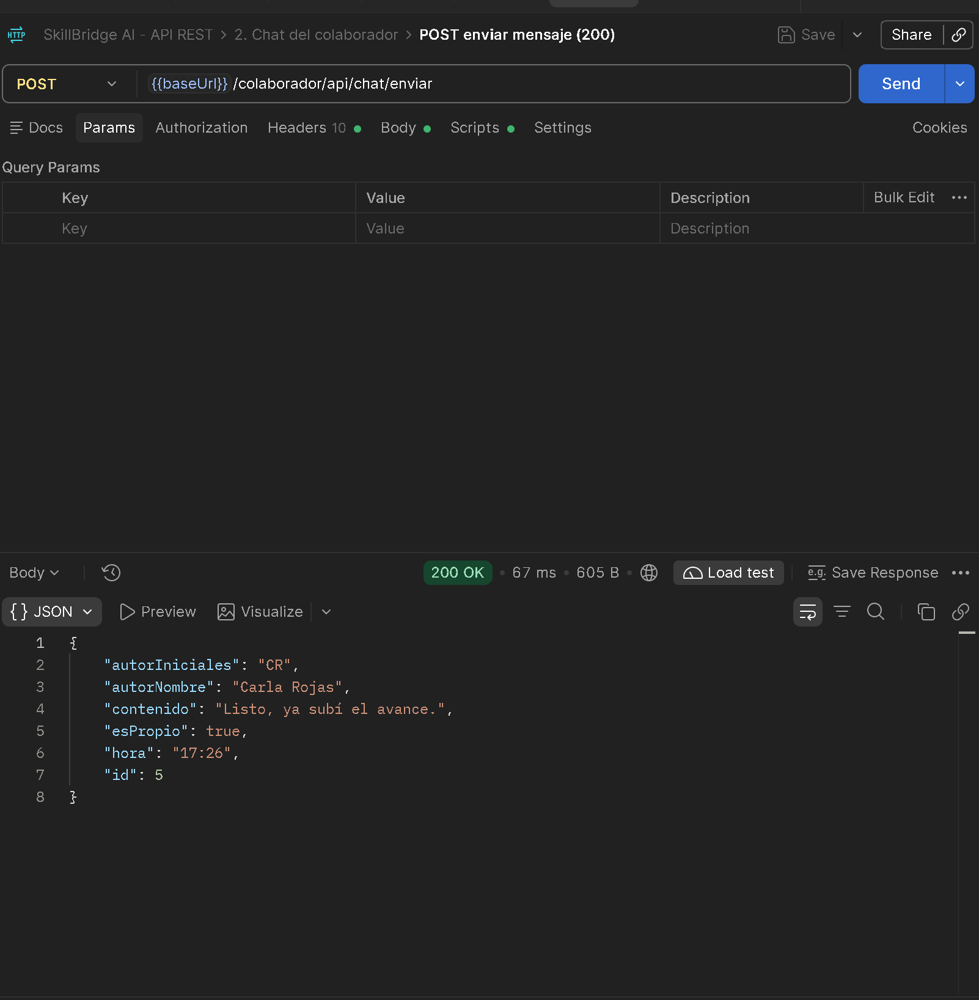 · Solicitud incorrecta: 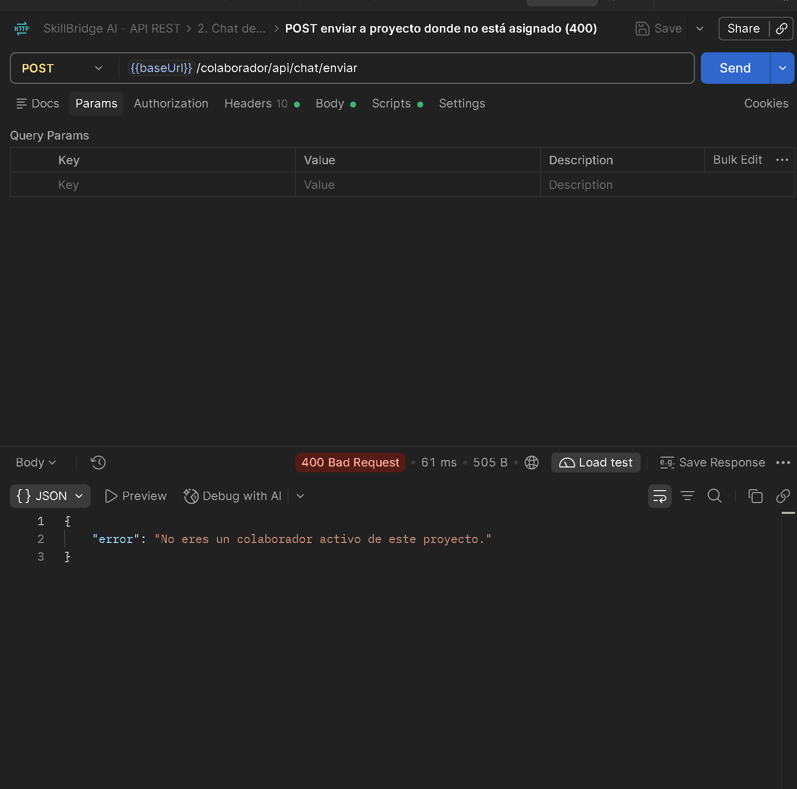

---

### Consumo API REST para listar las notificaciones

| URL | Method |
|---|---|
| `http://{servidor}:8080/api/notificaciones` | GET |

**Autenticación:** sesión con cualquier rol.

**Argumentos de entrada:** Ninguno (se usan las notificaciones del usuario con sesión).

**Argumentos de salida:**

Opción 1: Solicitud correcta
Http Status: HTTP 200 OK
Body:
```json
[
  {
    "id": 3,
    "titulo": "Evidencia de curso pendiente de revision",
    "descripcion": "Elena Torres subio evidencia para el curso \"[DEMO] AWS Cloud Practitioner\".",
    "categoria": "CURSO",
    "leida": false,
    "fechaCreacion": "2026-11-10T12:42:27",
    "url": "/rm/cursos/solicitudes?estado=EVIDENCIA_PENDIENTE"
  }
]
```

Opción 2: Sin sesión
Http Status: HTTP 401 Unauthorized (sin body).

**Datos de salida:**

| Campo | Tipo de dato | Observaciones |
|---|---|---|
| id | entero | Id de la notificación |
| titulo | cadena | Título corto |
| descripcion | cadena | Detalle del evento |
| categoria | cadena | `PROYECTO`, `ASIGNACION`, `ACTIVIDAD`, `CURSO`, `HABILIDAD`, `MENSAJE`, `HORAS` o `SISTEMA` |
| leida | booleano | true/false |
| fechaCreacion | cadena (fecha-hora ISO 8601) | Se ordena de la más reciente a la más antigua |
| url | cadena | Pantalla a la que lleva la notificación según el rol del usuario |

Se devuelven como máximo 20 notificaciones.

**Ejemplos:** Solicitud correcta: 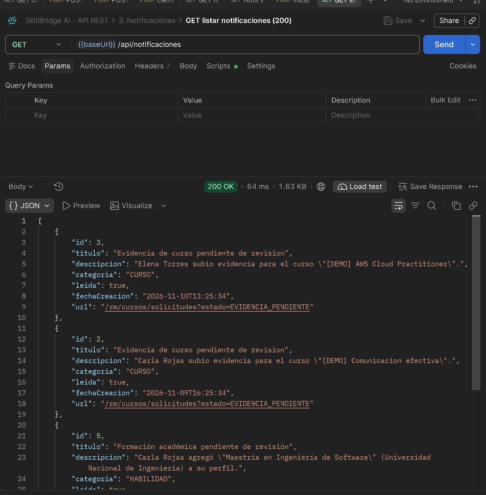 · Solicitud incorrecta (sin sesión): 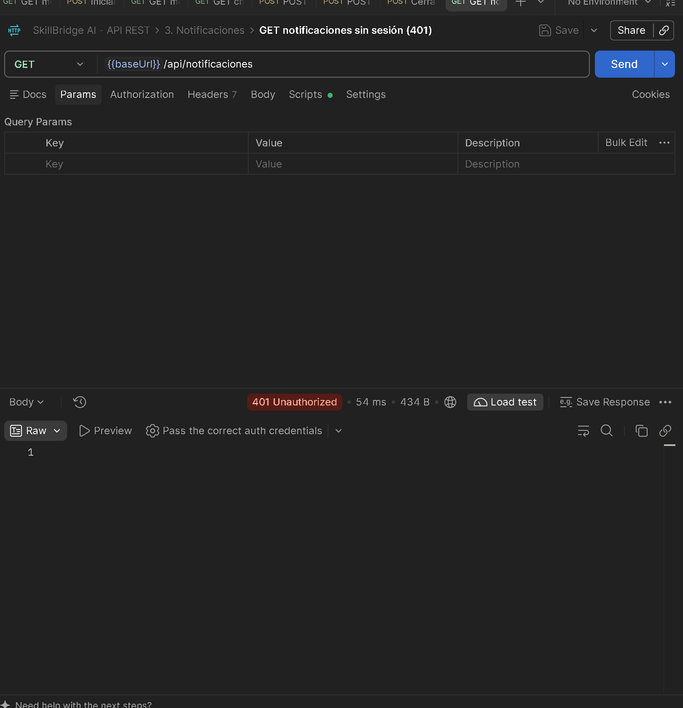

---

### Consumo API REST para marcar una notificación como leída

| URL | Method |
|---|---|
| `http://{servidor}:8080/api/notificaciones/{id}/leer` | POST |

**Autenticación:** sesión con cualquier rol + cabecera `X-CSRF-TOKEN`.

**Argumentos de entrada:**

| Campo | Tipo de dato | Observaciones |
|---|---|---|
| id | entero | En la ruta. Debe ser una notificación del propio usuario |

**Argumentos de salida:**

Opción 1: Solicitud correcta
Http Status: HTTP 204 No Content (sin body).

Opción 2: Error en los parámetros de la solicitud
Http Status: HTTP 400 Bad Request
Body:
```json
{ "error": "No se encontró la notificación." }
```
Se responde igual si la notificación no existe o si es de otro usuario, para no revelar qué ids existen. La
notificación ajena **no** se modifica. Con un id no numérico: `El valor del parámetro "id" no es válido.`

Opción 3: Sin token CSRF: HTTP 403 Forbidden. Sin sesión: HTTP 401 Unauthorized.

**Ejemplos:** Solicitud correcta: 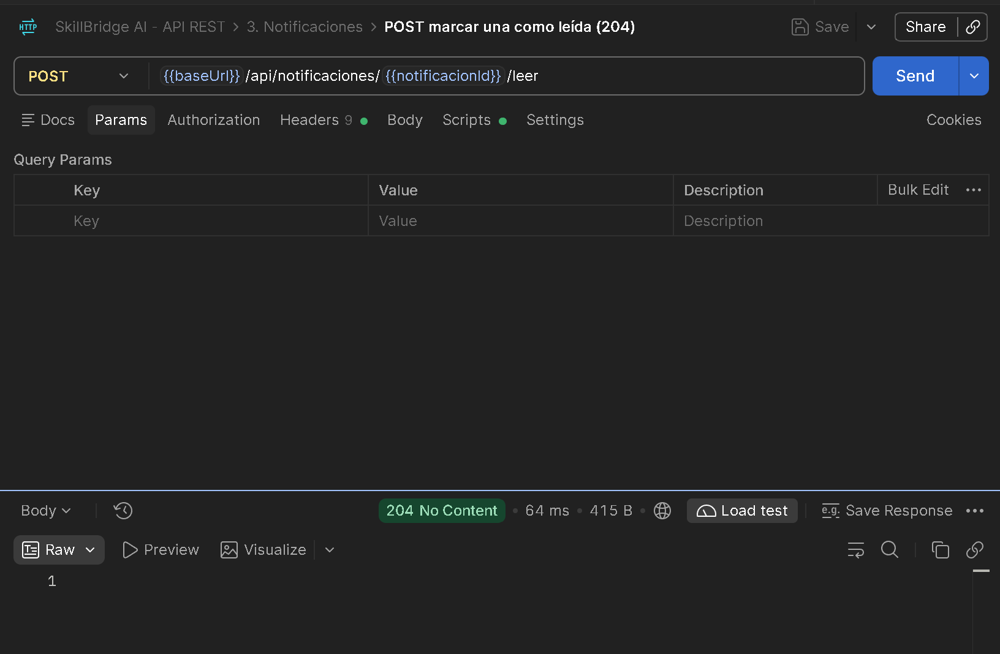 · Solicitud incorrecta: 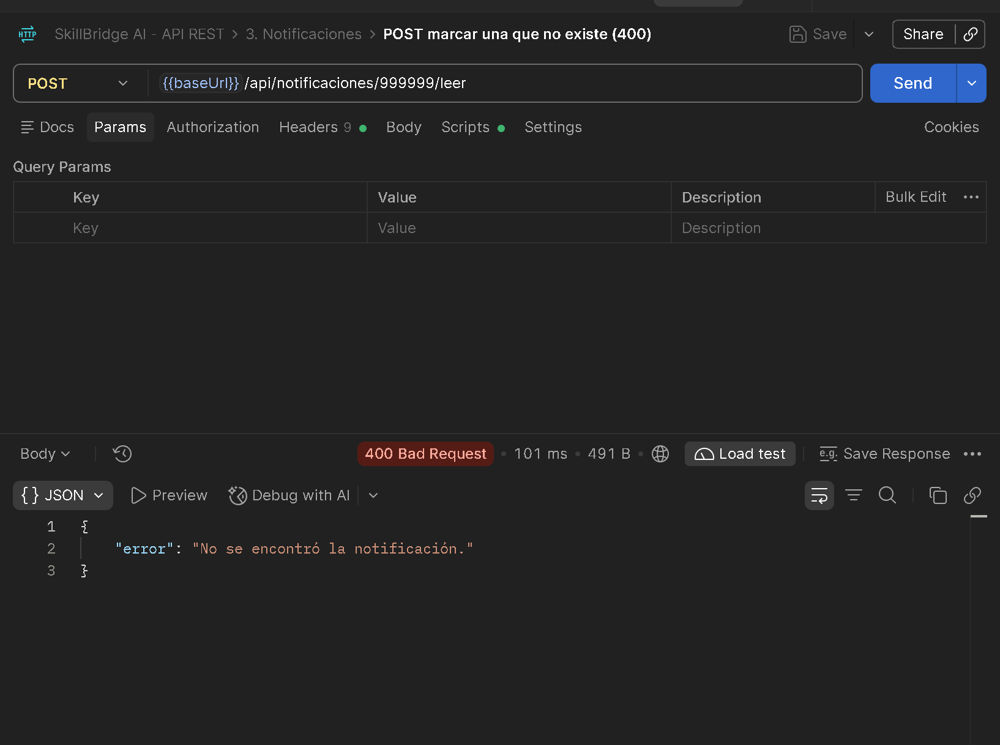

---

### Consumo API REST para marcar todas las notificaciones como leídas

| URL | Method |
|---|---|
| `http://{servidor}:8080/api/notificaciones/leer-todas` | POST |

**Autenticación:** sesión con cualquier rol + cabecera `X-CSRF-TOKEN`.

**Argumentos de entrada:** Ninguno.

**Argumentos de salida:**

Opción 1: Solicitud correcta
Http Status: HTTP 204 No Content (sin body).

Opción 2: Sin token CSRF
Http Status: HTTP 403 Forbidden
Body:
```json
{ "timestamp": "2026-11-10T20:45:53.641Z", "status": 403, "error": "Forbidden", "path": "/api/notificaciones/leer-todas" }
```

**Ejemplos:** Solicitud correcta: 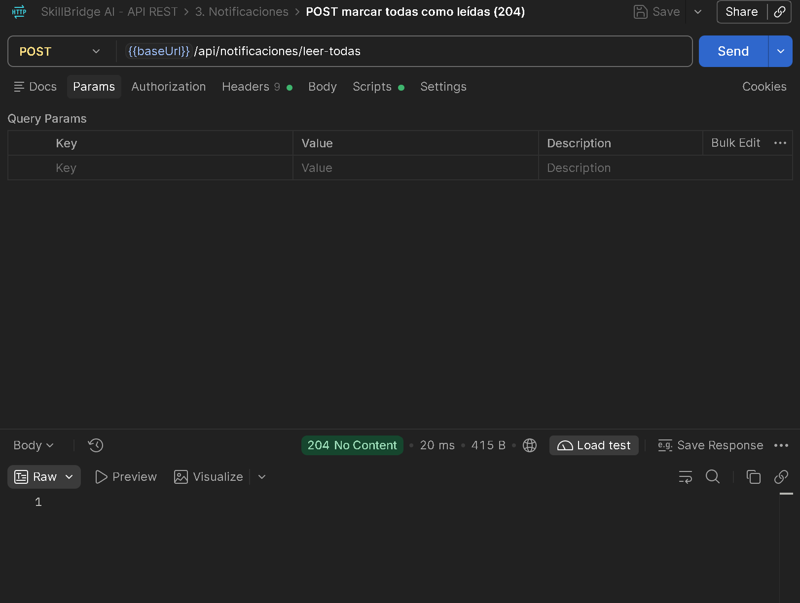 · Solicitud incorrecta (sin CSRF): 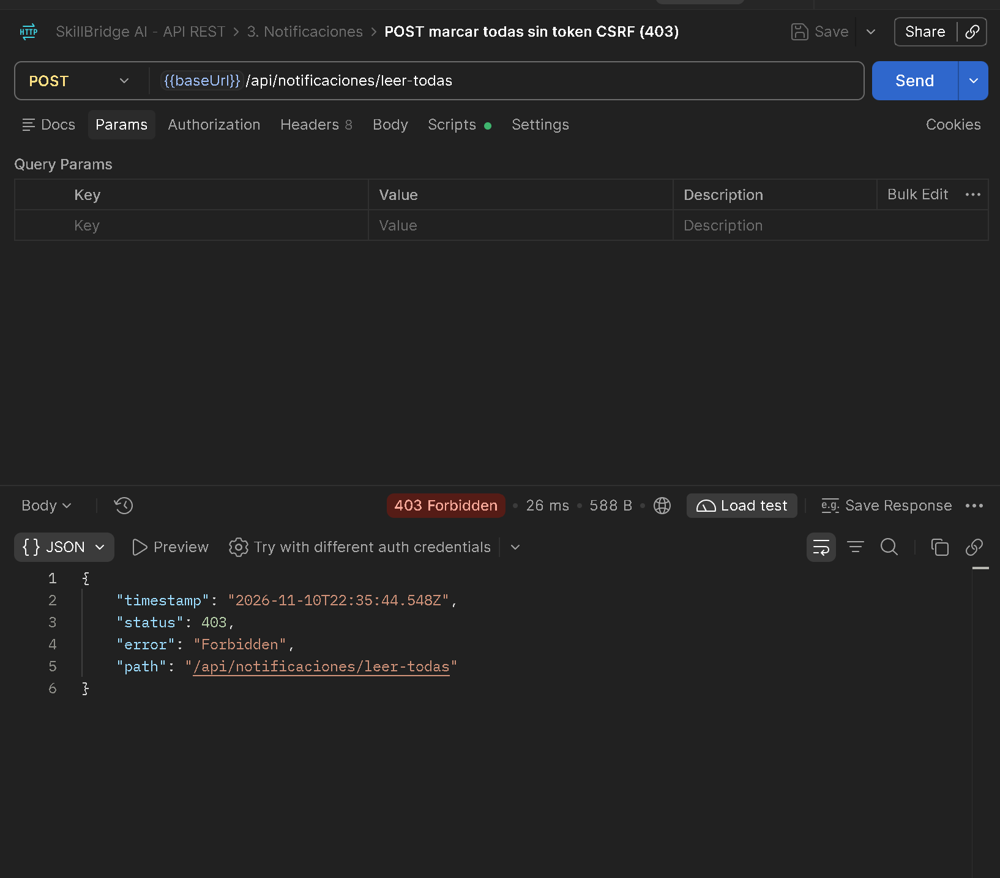

---

## 4.4 Corrección hecha al documentar la API

Al probar la API (10/11/2026) se encontró que 5 de los 8 endpoints respondían sus errores con una redirección
(302) a otra página en vez de un JSON, porque los atendía `GlobalExceptionHandler`, pensado para las vistas.
También, sin sesión, la API redirigía al login en vez de responder 401, y el chat del colaborador no tenía el
límite de 1000 caracteres del chat del PM. Se corrigió así:

| Cambio | Archivo |
|---|---|
| `@RestControllerAdvice` que devuelve `{"error": ...}` con 400/403/409 solo para los tres controladores REST | `controller/ApiErrorAdvice.java` (nuevo) |
| Las rutas de API responden 401 sin sesión; las vistas siguen yendo al login | `config/SecurityConfig.java` |
| Mismas reglas de mensaje en el chat del colaborador que en el del PM | `service/col/ColChatService.java` |
| La vista del chat del colaborador muestra el mensaje de error que devuelve la API | `templates/col/col-chat.html` |
| 8 pruebas nuevas | `ApiRestTests.java` |

## 4.5 Colección de Postman

Archivo: [`postman/SkillBridge_API.postman_collection.json`](postman/SkillBridge_API.postman_collection.json)

- 3 carpetas (Chat del PM, Chat del colaborador, Notificaciones) con 26 peticiones, cada una con sus tests.
- Cada carpeta abre `/login`, inicia sesión, prueba casos correctos y de error, y cierra sesión. Se incluyen
  casos sin sesión (401), sin CSRF (403) y con rol equivocado (403).
- Un script guarda el token CSRF de cada respuesta HTML en la variable `csrf`.
- Antes de ejecutarla: cambiar `baseUrl` (por defecto `http://localhost:8080`) y escribir la contraseña demo en
  la variable `password`. **No se guarda ninguna contraseña en el archivo.**
- Se ejecuta con *Run collection* y en orden: la carpeta del PM crea el chat que usa luego la del colaborador.
  El reporte del runner es la evidencia para la sección 7.
