# 4. APIs REST implementadas

> Borrador para el informe. Todo lo de esta sección sale del código (`controller/*RestController.java`,
> `NotificacionController.java`, `ApiErrorAdvice.java`, `SecurityConfig.java`, `WebSocketConfig.java`) y de
> pruebas reales hechas sobre una copia local con los datos demo (`skillbridge_db_v4.sql` +
> `datos_demo_rm_proyectos.sql`): el 10/11/2026 los 7 primeros endpoints y el 16/11/2026 todos, después de los
> cambios del chat y del asistente IA. Las capturas de Postman están en `capturas/`.

SkillBridge AI es principalmente una aplicación web con vistas Thymeleaf. Las pantallas que necesitan
actualizarse sin recargar la página consumen una API REST propia que devuelve JSON:

- **Chat del proyecto** (PM, colaborador y RM): canal grupal del proyecto, mensajes privados entre sus miembros,
  contador de no leídos y chat privado RM–PM (`static/js/chat.js`).
- **Asistente del colaborador**: responde consultas con datos internos (foros, cursos, proyectos) y, si está
  configurado, con un modelo de IA externo (Gemini o Claude). Desde la respuesta el colaborador puede solicitar
  un curso o postularse a un proyecto (`static/js/col-js/col-asistente.js`).
- **Notificaciones** (todos los roles): la campana de la topbar lista las notificaciones y las marca como leídas
  (`static/js/notificaciones.js`).

Además, un **WebSocket** avisa en tiempo real cuando llega un mensaje nuevo al chat (sección 4.4).

## 4.1 Tabla resumen

| Módulo | Método | URL | Descripción | Rol | HTTP |
|---|---|---|---|---|---|
| Chat del PM | GET | `/pm/api/chat/companeros?proyectoId={id}` | Contactos del PM en el proyecto: el RM responsable y los colaboradores activos | Project Manager | 200, 400, 401 |
| Chat del PM | GET | `/pm/api/chat/noleidos?proyectoId={id}` | Mensajes no leídos por chat: grupo y cada contacto | Project Manager | 200, 400, 401 |
| Chat del PM | GET | `/pm/api/chat/mensajes?proyectoId={id}[&usuarioId={id}]` | Mensajes del chat grupal o, con `usuarioId`, del chat privado con ese contacto | Project Manager | 200, 400, 401 |
| Chat del PM | POST | `/pm/api/chat/enviar` | Envía un mensaje al chat grupal o, con `usuarioId`, a un contacto | Project Manager | 200, 400, 401, 403 |
| Chat del colaborador | GET | `/colaborador/api/chat/companeros?proyectoId={id}` | Contactos del colaborador en el proyecto: el PM y sus compañeros activos | Colaborador | 200, 400, 401 |
| Chat del colaborador | GET | `/colaborador/api/chat/noleidos?proyectoId={id}` | Mensajes no leídos por chat: grupo y cada contacto | Colaborador | 200, 400, 401 |
| Chat del colaborador | GET | `/colaborador/api/chat/mensajes?proyectoId={id}[&usuarioId={id}]` | Mensajes del chat grupal o del chat privado con un contacto | Colaborador | 200, 400, 401 |
| Chat del colaborador | POST | `/colaborador/api/chat/enviar` | Envía un mensaje al chat grupal o a un contacto | Colaborador | 200, 400, 401, 403 |
| Chat del RM | GET | `/rm/api/chat/noleidos` | Mensajes no leídos del PM en cada proyecto del RM | Resource Manager | 200, 401, 403 |
| Chat del RM | GET | `/rm/api/chat/mensajes?proyectoId={id}` | Chat privado RM–PM de un proyecto del RM | Resource Manager | 200, 400, 401 |
| Chat del RM | POST | `/rm/api/chat/enviar` | Envía un mensaje al PM del proyecto | Resource Manager | 200, 400, 401, 403 |
| Asistente | POST | `/colaborador/api/asistente/mensaje` | Responde una consulta del colaborador | Colaborador | 200, 400, 401, 403 |
| Asistente | GET | `/colaborador/api/asistente/historial` | Historial de la conversación con la IA en la sesión | Colaborador | 200, 401, 403 |
| Asistente | POST | `/colaborador/api/asistente/historial/limpiar` | Reinicia la conversación | Colaborador | 200, 401, 403 |
| Asistente | POST | `/colaborador/api/asistente/acciones/solicitar-curso` | Solicita la inscripción a un curso sugerido | Colaborador | 200, 400, 401, 403 |
| Asistente | POST | `/colaborador/api/asistente/acciones/solicitar-proyecto` | Solicita incorporarse a un proyecto sugerido | Colaborador | 200, 400, 401, 403 |
| Notificaciones | GET | `/api/notificaciones` | Lista las 20 notificaciones más recientes del usuario | Cualquier rol autenticado | 200, 401 |
| Notificaciones | POST | `/api/notificaciones/{id}/leer` | Marca como leída una notificación del usuario | Cualquier rol autenticado | 204, 400, 401, 403 |
| Notificaciones | POST | `/api/notificaciones/leer-todas` | Marca como leídas todas las notificaciones del usuario | Cualquier rol autenticado | 204, 401, 403 |

En total son **19 endpoints**. No hay `PUT` ni `DELETE`: el chat no permite editar ni borrar mensajes y las
notificaciones solo cambian de estado. Las altas, ediciones y bajas del resto del sistema se hacen con
formularios Thymeleaf (`@Controller`), no por API.

**Códigos HTTP usados**

| Código | Cuándo |
|---|---|
| 200 OK | Consulta o envío correcto con respuesta JSON |
| 204 No Content | Notificación(es) marcada(s) como leída(s); sin body |
| 400 Bad Request | Dato inválido o faltante, recurso que no existe o no le pertenece al usuario, o JSON mal formado. Body `{"error": "..."}` |
| 401 Unauthorized | Petición sin sesión iniciada; sin body |
| 403 Forbidden | Falta el token CSRF en un POST, o el rol no corresponde a la ruta |
| 409 Conflict | La operación no se puede hacer en el estado actual (`IllegalStateException`). Body `{"error": "..."}` |
| 500 Internal Server Error | Error inesperado; se registra en el log y el usuario recibe un mensaje sin detalles técnicos |

## 4.2 Autenticación y seguridad

| Aspecto | Cómo funciona en el proyecto |
|---|---|
| Autenticación | Spring Security con formulario (`POST /login`, campos `username` y `password`). La API usa la **misma sesión** que las vistas; la sesión se guarda en MySQL con Spring Session JDBC (cookie `SESSION`). No hay tokens JWT ni API keys. |
| Sin sesión | Las rutas `/api/**`, `/pm/api/**`, `/colaborador/api/**`, `/rm/api/**` y `/ws-chat/**` responden **401**; las vistas siguen redirigiendo a `/login` (`SecurityConfig`). |
| Autorización por rol | Por URL en `SecurityConfig`: `/pm/**` exige `PROJECT_MANAGER`, `/colaborador/**` exige `COLABORADOR`, `/rm/**` exige `RESOURCE_MANAGER`. `/api/notificaciones/**` exige solo sesión iniciada. Rol equivocado: **403**. |
| Autorización por dato | Los servicios comprueban la pertenencia: el PM solo usa el chat de sus proyectos (`PmChatService`), el colaborador solo el de proyectos con asignación `ACTIVA` (`ColChatService`), el RM solo el de proyectos donde es el responsable (`RmChatService`). Un mensaje privado solo puede ir a un miembro del proyecto. Cada usuario solo marca sus propias notificaciones. |
| CSRF | Activo. Todo `POST` debe enviar el token en la cabecera `X-CSRF-TOKEN`; las vistas lo leen de `<meta name="_csrf">` (`static/js/csrf.js`). Sin token: **403**. |
| Errores | Un solo `@RestControllerAdvice` (`ApiErrorAdvice`) para los cinco controladores REST convierte los errores en JSON `{"error": "mensaje"}` con su código HTTP. Los mensajes están escritos para el usuario y no exponen detalles técnicos. |
| Límite de peticiones | `LimiteSolicitudesFilter` limita las peticiones por IP y por minuto (429). El asistente además acepta como máximo `IA_MENSAJES_POR_MINUTO` consultas por usuario y por minuto (10 por defecto); al superarlo responde 429. |
| IA externa | La llave del proveedor de IA se lee de la variable de entorno `IA_API_KEY`; nunca va en el código ni en el repositorio. Sin llave, el asistente funciona en modo sin IA (responde solo con datos internos). |
| CORS | No se configura: la API solo la consume el propio sitio (mismo origen). |
| Validación de entrada | En el servicio: proyecto obligatorio, mensaje no vacío, máximo 1000 caracteres y sin espacios al inicio ni al final (mismas reglas en los tres chats, `ChatBaseService`). |

## 4.3 Fichas de cada endpoint

Formato de la clase 9.2 ("Documentación listar/obtener Productos"). Los objetos que se repiten (mensaje, contacto)
se describen una vez en 4.3.1.

### 4.3.1 Objetos de respuesta comunes

**Mensaje** (`PmMensajeView`), lo devuelven todos los endpoints de mensajes y de envío:

| Campo | Tipo de dato | Observaciones |
|---|---|---|
| id | entero | Id del mensaje |
| autorNombre | cadena | Nombre y apellido del autor |
| autorIniciales | cadena | Iniciales en mayúscula, para el avatar |
| contenido | cadena | Texto del mensaje |
| hora | cadena | Hora de envío en formato `HH:mm` |
| esPropio | booleano | true si el autor es el usuario que consulta |

**Contacto** (`ChatContactoView`):

| Campo | Tipo de dato | Observaciones |
|---|---|---|
| id | entero | Id del usuario; es el `usuarioId` que se usa para el chat privado |
| nombre | cadena | Nombre y apellido |
| iniciales | cadena | Iniciales en mayúscula |
| rol | cadena | `Project Manager`, `Resource Manager` o `Colaborador` |

**No leídos**: objeto JSON cuyas llaves son `"grupo"` (chat grupal) y el id de cada contacto (chat privado); el
valor es la cantidad de mensajes sin leer. En el RM, las llaves son los ids de sus proyectos.

---

### Consumo API REST para listar los contactos del chat (PM y colaborador)

| URL | Method |
|---|---|
| `http://{servidor}:8080/pm/api/chat/companeros?proyectoId={id}` | GET |
| `http://{servidor}:8080/colaborador/api/chat/companeros?proyectoId={id}` | GET |

**Autenticación:** sesión con rol Project Manager o Colaborador, según la ruta.

**Argumentos de entrada:**

| Campo | Tipo de dato | Observaciones |
|---|---|---|
| proyectoId | entero | Obligatorio. PM: un proyecto suyo. Colaborador: un proyecto con asignación activa |

**Argumentos de salida:**

Opción 1: Solicitud correcta
Http Status: HTTP 200 OK
Body (PM del proyecto 8):
```json
[
  { "id": 11, "nombre": "Rosa Mendoza", "iniciales": "RM", "rol": "Resource Manager" },
  { "id": 13, "nombre": "Carla Rojas", "iniciales": "CR", "rol": "Colaborador" },
  { "id": 14, "nombre": "Diego Salazar", "iniciales": "DS", "rol": "Colaborador" },
  { "id": 15, "nombre": "Elena Torres", "iniciales": "ET", "rol": "Colaborador" }
]
```
Para el colaborador la lista trae al PM y a sus compañeros activos; el RM no aparece.

Opción 2: Error en los parámetros de la solicitud
Http Status: HTTP 400 Bad Request
Body:
```json
{ "error": "No eres el PM de este proyecto." }
```

| Caso | `error` devuelto |
|---|---|
| PM sin `proyectoId` | Falta el parámetro "proyectoId". |
| Colaborador sin `proyectoId` | Debes seleccionar un proyecto. |
| Proyecto de otro PM | No eres el PM de este proyecto. |
| Colaborador sin asignación activa en el proyecto | No eres un colaborador activo de este proyecto. |

**Datos de salida:** lista de **Contacto** (4.3.1).

**Ejemplos:** Solicitud correcta `[pendiente: capturas/15-pm-companeros-200.png]` · Solicitud incorrecta `[pendiente: capturas/16-pm-companeros-400.png]` · Colaborador: `[pendiente: capturas/21-col-companeros-200.png]`, `[pendiente: capturas/22-col-companeros-400.png]`

---

### Consumo API REST para consultar los mensajes no leídos (PM y colaborador)

| URL | Method |
|---|---|
| `http://{servidor}:8080/pm/api/chat/noleidos?proyectoId={id}` | GET |
| `http://{servidor}:8080/colaborador/api/chat/noleidos?proyectoId={id}` | GET |

**Autenticación:** sesión con rol Project Manager o Colaborador, según la ruta.

**Argumentos de entrada:**

| Campo | Tipo de dato | Observaciones |
|---|---|---|
| proyectoId | entero | Obligatorio. Mismas reglas que los contactos |

**Argumentos de salida:**

Opción 1: Solicitud correcta
Http Status: HTTP 200 OK
Body (colaborador con un mensaje privado del PM y uno en el grupo):
```json
{ "grupo": 1, "12": 1, "14": 0, "15": 0 }
```

Opción 2: Error en los parámetros de la solicitud
Http Status: HTTP 400 Bad Request
Body:
```json
{ "error": "El valor del parámetro \"proyectoId\" no es válido." }
```
Los demás errores son los mismos que en los contactos.

**Datos de salida:** objeto **No leídos** (4.3.1).

**Ejemplos:** `[pendiente: capturas/17-pm-noleidos-200.png]` · `[pendiente: capturas/18-pm-noleidos-400.png]` · Colaborador: `[pendiente: capturas/23-col-noleidos-200.png]`, `[pendiente: capturas/24-col-noleidos-400.png]`

---

### Consumo API REST para listar los mensajes del chat (PM)

| URL | Method |
|---|---|
| `http://{servidor}:8080/pm/api/chat/mensajes?proyectoId={id}&usuarioId={id}` | GET |

**Autenticación:** sesión iniciada con rol Project Manager.

**Argumentos de entrada:**

| Campo | Tipo de dato | Observaciones |
|---|---|---|
| proyectoId | entero | Obligatorio (query string). Debe ser un proyecto cuyo PM es el usuario con sesión |
| usuarioId | entero | Opcional. Sin él se devuelve el chat grupal; con él, el chat privado con ese contacto (un colaborador activo o el RM del proyecto) |

**Argumentos de salida:**

Opción 1: Solicitud correcta
Http Status: HTTP 200 OK
Body:
```json
[
  {
    "id": 1,
    "autorNombre": "Pablo Morales",
    "autorIniciales": "PM",
    "contenido": "Hola equipo, reunion el lunes a las 10.",
    "hora": "15:45",
    "esPropio": true
  }
]
```
Si el proyecto todavía no tiene chat grupal, se crea vacío y se devuelve `[]`. Al consultar, los mensajes quedan
marcados como leídos para el usuario.

Opción 2: Error en los parámetros de la solicitud
Http Status: HTTP 400 Bad Request
Body:
```json
{ "error": "No eres el PM de este proyecto." }
```

| Caso | `error` devuelto |
|---|---|
| Sin `proyectoId` | Falta el parámetro "proyectoId". |
| `proyectoId` no numérico | El valor del parámetro "proyectoId" no es válido. |
| Proyecto de otro PM | No eres el PM de este proyecto. |
| Proyecto inexistente | Proyecto no encontrado. |

Opción 3: Sin sesión
Http Status: HTTP 401 Unauthorized (sin body).

**Datos de salida:** lista de **Mensaje** (4.3.1).

**Ejemplos:** Solicitud correcta: 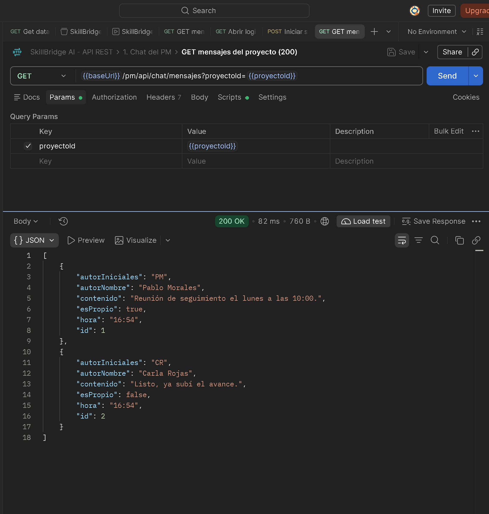 · Solicitud incorrecta: 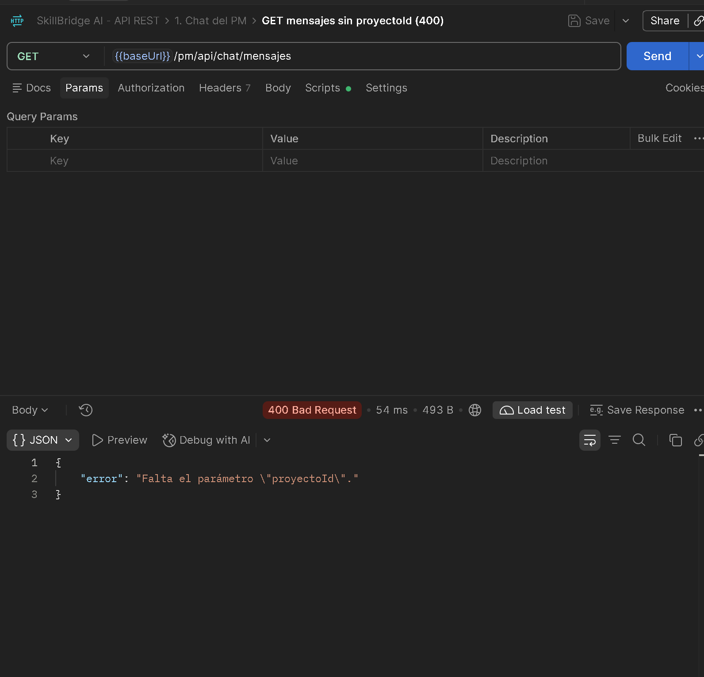

---

### Consumo API REST para enviar un mensaje al chat (PM)

| URL | Method |
|---|---|
| `http://{servidor}:8080/pm/api/chat/enviar` | POST |

**Autenticación:** sesión con rol Project Manager + cabecera `X-CSRF-TOKEN`.
**Formato de entrada:** `application/x-www-form-urlencoded`.

**Argumentos de entrada:**

| Campo | Tipo de dato | Observaciones |
|---|---|---|
| proyectoId | entero | Obligatorio. Proyecto del PM con sesión |
| usuarioId | entero | Opcional. Sin él va al chat grupal; con él, mensaje privado a un colaborador activo o al RM del proyecto |
| contenido | cadena | Obligatorio, no puede estar vacío ni tener solo espacios. Máximo 1000 caracteres. Se guarda sin espacios al inicio y al final |

**Argumentos de salida:**

Opción 1: Solicitud correcta
Http Status: HTTP 200 OK
Body:
```json
{
  "id": 2,
  "autorNombre": "Pablo Morales",
  "autorIniciales": "PM",
  "contenido": "Hola Carla, revisa tu tarea",
  "hora": "23:56",
  "esPropio": true
}
```

Opción 2: Error en los parámetros de la solicitud
Http Status: HTTP 400 Bad Request
Body (el texto de `error` cambia según la regla que falla):
```json
{ "error": "El mensaje no puede estar vacío." }
```

| Caso | `error` devuelto |
|---|---|
| Sin `proyectoId` | Debes seleccionar un proyecto para enviar un mensaje. |
| `contenido` vacío o con espacios | El mensaje no puede estar vacío. |
| Más de 1000 caracteres | El mensaje no puede superar los 1000 caracteres. |
| Proyecto de otro PM | No eres el PM de este proyecto. |
| Proyecto inexistente | Proyecto no encontrado. |
| `usuarioId` que no es colaborador activo del proyecto | Ese colaborador no está activo en este proyecto. |

Opción 3: Sin token CSRF
Http Status: HTTP 403 Forbidden
Body:
```json
{ "timestamp": "2026-11-10T20:44:51.936Z", "status": 403, "error": "Forbidden", "path": "/pm/api/chat/enviar" }
```

**Datos de salida:** un **Mensaje** (4.3.1).

**Ejemplos:** Grupal: 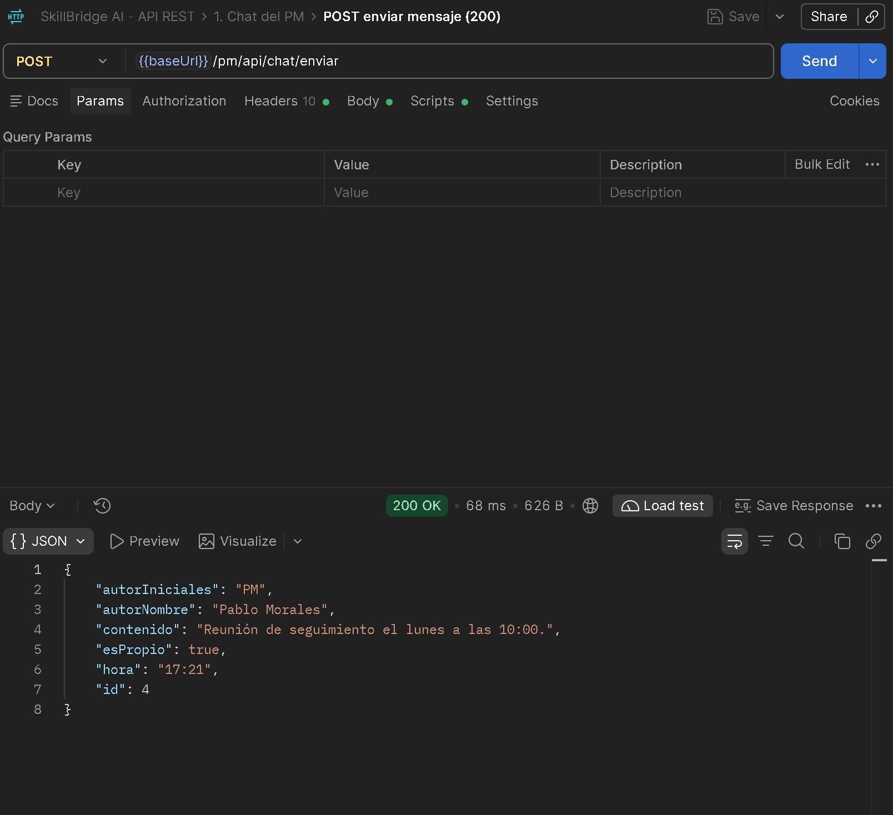 · 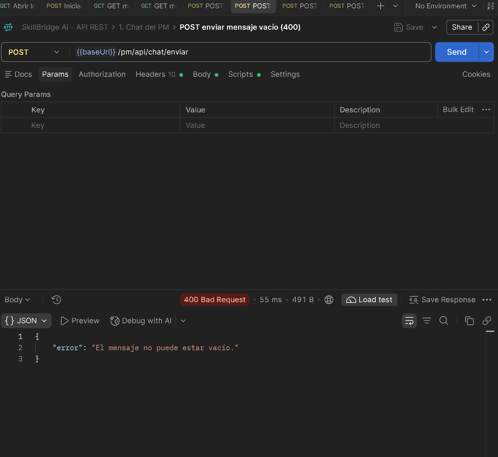 · Privado: `[pendiente: capturas/19-pm-privado-200.png]`, `[pendiente: capturas/20-pm-privado-400.png]`

---

### Consumo API REST para listar los mensajes del chat (colaborador)

| URL | Method |
|---|---|
| `http://{servidor}:8080/colaborador/api/chat/mensajes?proyectoId={id}&usuarioId={id}` | GET |

**Autenticación:** sesión con rol Colaborador.

**Argumentos de entrada:**

| Campo | Tipo de dato | Observaciones |
|---|---|---|
| proyectoId | entero | Obligatorio. El colaborador debe tener una asignación `ACTIVA` en ese proyecto |
| usuarioId | entero | Opcional. Chat privado con el PM o con un compañero activo del proyecto |

**Argumentos de salida:**

Opción 1: Solicitud correcta
Http Status: HTTP 200 OK
Body:
```json
[
  { "id": 1, "autorNombre": "Pablo Morales", "autorIniciales": "PM", "contenido": "Reunion de seguimiento el lunes", "hora": "23:56", "esPropio": false },
  { "id": 6, "autorNombre": "Carla Rojas", "autorIniciales": "CR", "contenido": "Buenos dias equipo", "hora": "23:56", "esPropio": true }
]
```

Opción 2: Error en los parámetros de la solicitud
Http Status: HTTP 400 Bad Request
Body:
```json
{ "error": "No eres un colaborador activo de este proyecto." }
```

| Caso | `error` devuelto |
|---|---|
| Sin `proyectoId` | Debes seleccionar un proyecto. |
| Proyecto sin asignación activa del colaborador | No eres un colaborador activo de este proyecto. |
| Proyecto inexistente | Proyecto no encontrado. |

Opción 3: Sin sesión: HTTP 401 Unauthorized. Con otro rol: HTTP 403 Forbidden.

**Datos de salida:** lista de **Mensaje** (4.3.1).

**Ejemplos:** Solicitud correcta: 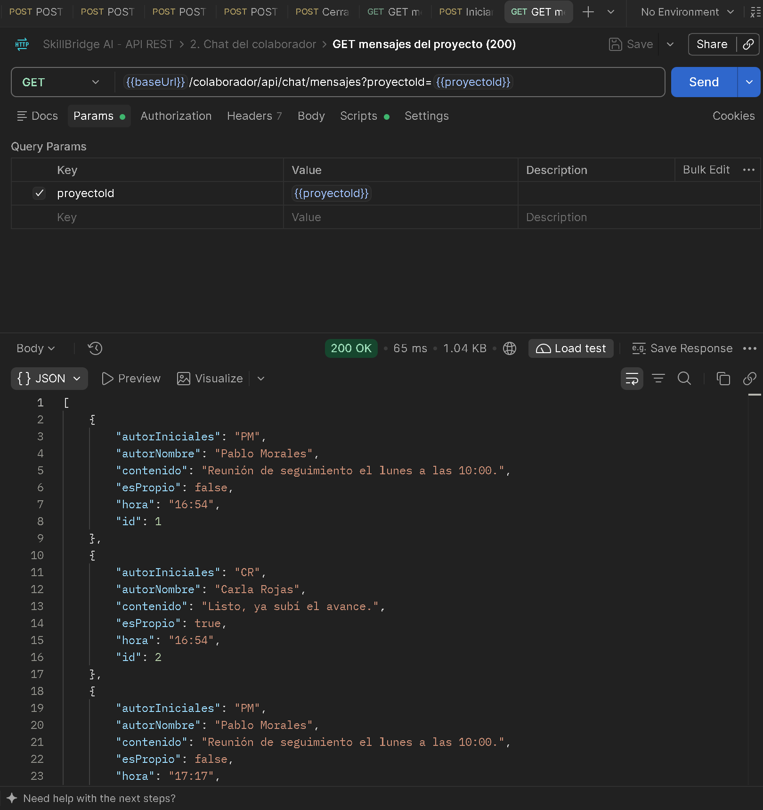 · Solicitud incorrecta (rol equivocado): 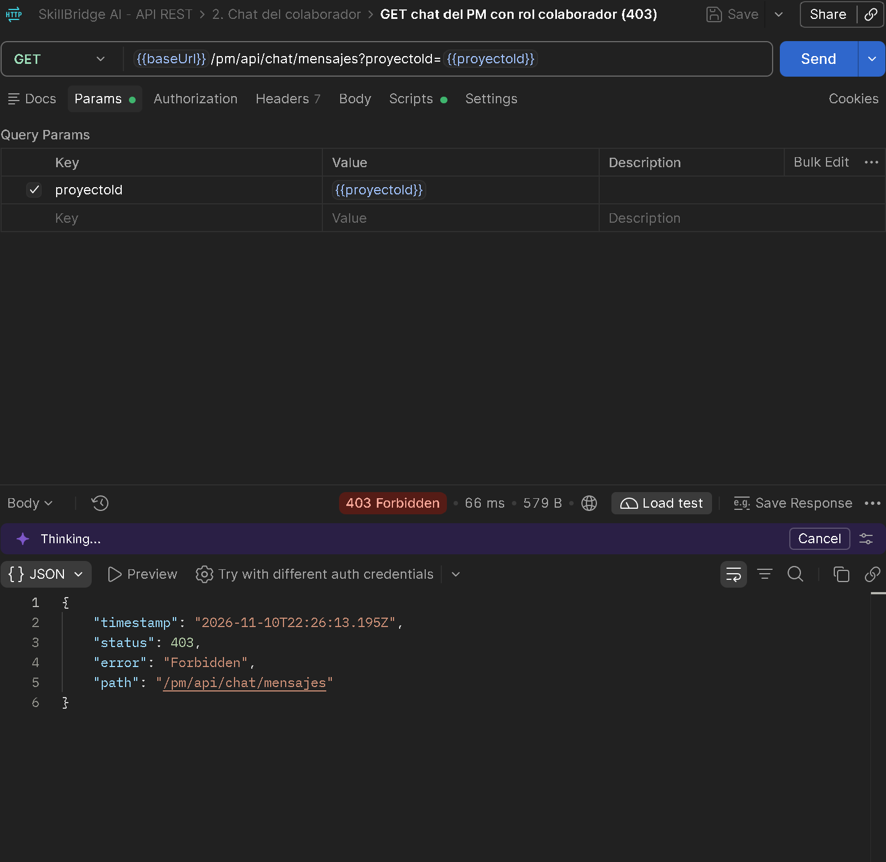

---

### Consumo API REST para enviar un mensaje al chat (colaborador)

| URL | Method |
|---|---|
| `http://{servidor}:8080/colaborador/api/chat/enviar` | POST |

**Autenticación:** sesión con rol Colaborador + cabecera `X-CSRF-TOKEN`.
**Formato de entrada:** `application/x-www-form-urlencoded`.

**Argumentos de entrada:**

| Campo | Tipo de dato | Observaciones |
|---|---|---|
| proyectoId | entero | Obligatorio. Proyecto con asignación `ACTIVA` del colaborador |
| usuarioId | entero | Opcional. Mensaje privado al PM o a un compañero activo |
| contenido | cadena | Obligatorio, no vacío, máximo 1000 caracteres. Se guarda sin espacios al inicio y al final |

**Argumentos de salida:**

Opción 1: Solicitud correcta
Http Status: HTTP 200 OK
Body:
```json
{ "id": 5, "autorNombre": "Carla Rojas", "autorIniciales": "CR", "contenido": "Diego, me pasas el diagrama?", "hora": "23:56", "esPropio": true }
```
El colaborador puede escribir en el grupo aunque el PM todavía no lo haya abierto: el chat se crea solo.

Opción 2: Error en los parámetros de la solicitud
Http Status: HTTP 400 Bad Request
Body:
```json
{ "error": "Esa persona no es parte de este proyecto." }
```

| Caso | `error` devuelto |
|---|---|
| Sin `proyectoId` | Debes seleccionar un proyecto. |
| `contenido` vacío o con espacios | El mensaje no puede estar vacío. |
| Más de 1000 caracteres | El mensaje no puede superar los 1000 caracteres. |
| Proyecto sin asignación activa | No eres un colaborador activo de este proyecto. |
| `usuarioId` que no es el PM ni un compañero activo (por ejemplo, el RM) | Esa persona no es parte de este proyecto. |

Opción 3: Sin token CSRF: HTTP 403 Forbidden.

**Datos de salida:** un **Mensaje** (4.3.1).

**Ejemplos:** Grupal: 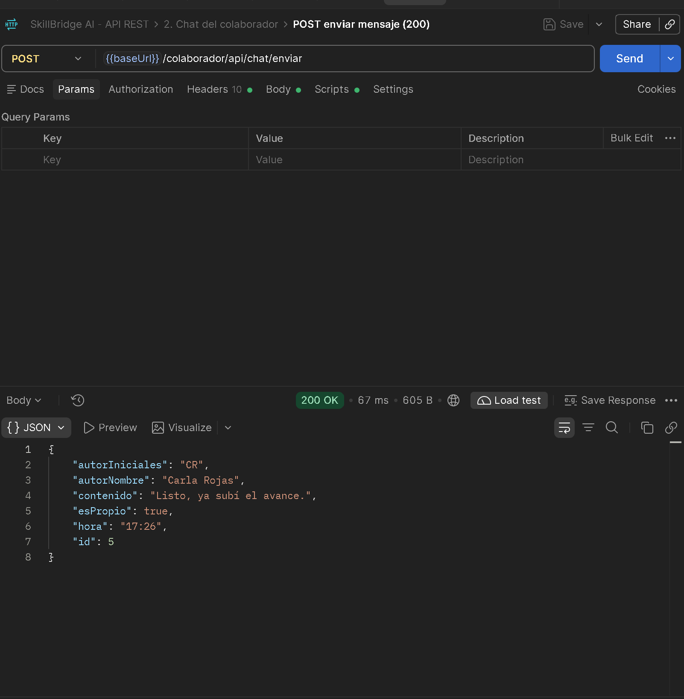 · 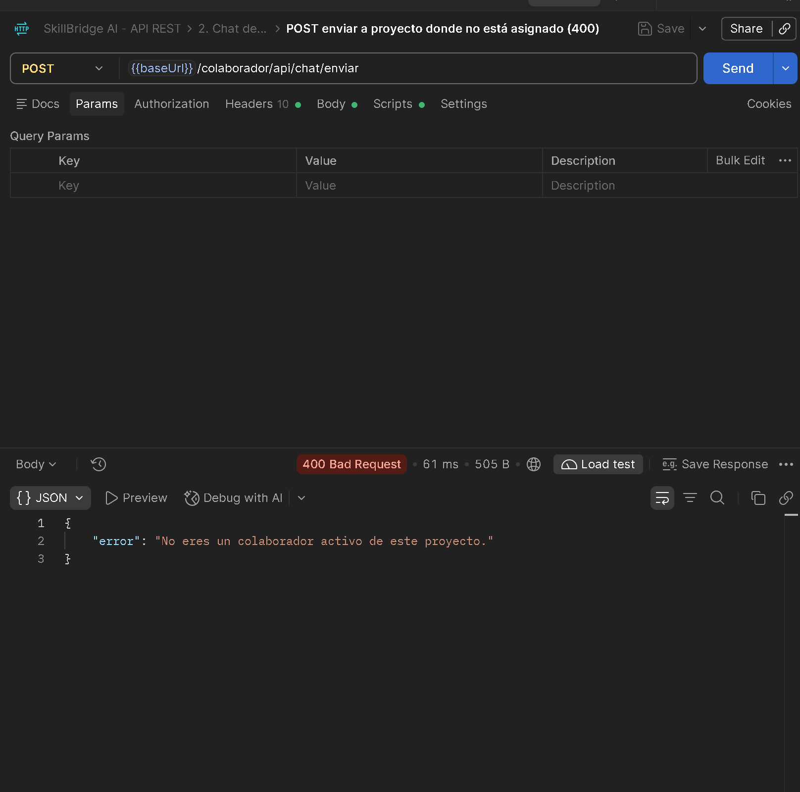 · Privado: `[pendiente: capturas/25-col-privado-200.png]`, `[pendiente: capturas/26-col-privado-400.png]`

---

### Consumo API REST para consultar los no leídos del RM

| URL | Method |
|---|---|
| `http://{servidor}:8080/rm/api/chat/noleidos` | GET |

**Autenticación:** sesión con rol Resource Manager.

**Argumentos de entrada:** Ninguno.

**Argumentos de salida:**

Opción 1: Solicitud correcta
Http Status: HTTP 200 OK
Body (llave = id del proyecto, valor = mensajes del PM sin leer):
```json
{ "8": 1, "9": 0, "11": 0, "12": 0, "13": 0 }
```

Opción 2: Con otro rol
Http Status: HTTP 403 Forbidden.

**Ejemplos:** `[pendiente: capturas/27-rm-noleidos-200.png]` · `[pendiente: capturas/28-rm-noleidos-403.png]`

---

### Consumo API REST para listar los mensajes del chat RM–PM

| URL | Method |
|---|---|
| `http://{servidor}:8080/rm/api/chat/mensajes?proyectoId={id}` | GET |

**Autenticación:** sesión con rol Resource Manager.

**Argumentos de entrada:**

| Campo | Tipo de dato | Observaciones |
|---|---|---|
| proyectoId | entero | Obligatorio. Proyecto donde el RM es el responsable |

**Argumentos de salida:**

Opción 1: Solicitud correcta
Http Status: HTTP 200 OK
Body:
```json
[
  { "id": 3, "autorNombre": "Pablo Morales", "autorIniciales": "PM", "contenido": "Rosa, necesito un QA", "hora": "23:56", "esPropio": false }
]
```
Es el mismo chat privado que el PM ve con `usuarioId` = id del RM.

Opción 2: Error en los parámetros de la solicitud
Http Status: HTTP 400 Bad Request
Body:
```json
{ "error": "No tienes acceso al chat de este proyecto." }
```

| Caso | `error` devuelto |
|---|---|
| Sin `proyectoId` | Falta el parámetro "proyectoId". |
| Proyecto donde no es el responsable (o sin responsable) | No tienes acceso al chat de este proyecto. |

**Datos de salida:** lista de **Mensaje** (4.3.1).

**Ejemplos:** `[pendiente: capturas/29-rm-mensajes-200.png]` · `[pendiente: capturas/30-rm-mensajes-400.png]`

---

### Consumo API REST para enviar un mensaje al PM (RM)

| URL | Method |
|---|---|
| `http://{servidor}:8080/rm/api/chat/enviar` | POST |

**Autenticación:** sesión con rol Resource Manager + cabecera `X-CSRF-TOKEN`.
**Formato de entrada:** `application/x-www-form-urlencoded`.

**Argumentos de entrada:**

| Campo | Tipo de dato | Observaciones |
|---|---|---|
| proyectoId | entero | Obligatorio. Proyecto donde el RM es el responsable |
| contenido | cadena | Obligatorio, no vacío, máximo 1000 caracteres |

**Argumentos de salida:**

Opción 1: Solicitud correcta
Http Status: HTTP 200 OK
Body:
```json
{ "id": 7, "autorNombre": "Rosa Mendoza", "autorIniciales": "RM", "contenido": "Pablo, te propongo a Elena para QA", "hora": "23:56", "esPropio": true }
```

Opción 2: Error en los parámetros de la solicitud
Http Status: HTTP 400 Bad Request

| Caso | `error` devuelto |
|---|---|
| Sin `proyectoId` | Debes seleccionar un proyecto. |
| `contenido` vacío | El mensaje no puede estar vacío. |
| Proyecto donde no es el responsable | No tienes acceso al chat de este proyecto. |

Opción 3: Sin token CSRF: HTTP 403 Forbidden.

**Ejemplos:** `[pendiente: capturas/31-rm-enviar-200.png]` · `[pendiente: capturas/32-rm-enviar-400.png]`

---

### Consumo API REST para consultar al asistente

| URL | Method |
|---|---|
| `http://{servidor}:8080/colaborador/api/asistente/mensaje` | POST |

**Autenticación:** sesión con rol Colaborador + cabecera `X-CSRF-TOKEN`.
**Formato de entrada:** `application/json`.

**Argumentos de entrada:**

| Campo | Tipo de dato | Observaciones |
|---|---|---|
| mensaje | cadena | Obligatorio. Consulta del colaborador |

```json
{ "mensaje": "Que cursos de AWS me recomiendas?" }
```

**Argumentos de salida:**

Opción 1: Solicitud correcta
Http Status: HTTP 200 OK
Body (modo sin IA, resumido):
```json
{
  "respuesta": "El servicio de IA no está disponible en este momento, pero esto es lo que encontré en SkillBridge relacionado con tu consulta:",
  "usoDatosInternos": true,
  "iaDisponible": false,
  "fuentes": [
    { "id": 2, "titulo": "[DEMO] Incidente en despliegue AWS", "foro": "[DEMO] Foro Migracion Cloud",
      "url": "/colaborador/foros/detalle?foroId=1#pub-2", "resuelta": true }
  ],
  "cursos": [
    { "id": 7, "nombre": "[DEMO] AWS Cloud Practitioner", "categoria": "Certificacion", "modalidad": null,
      "fechaInicio": null, "fechaFin": null, "horas": "32.00",
      "descripcion": "Fundamentos de servicios, seguridad y arquitectura en AWS.",
      "estado": "Sin solicitud", "puedeSolicitar": true }
  ],
  "proyectos": [],
  "acciones": []
}
```

Opción 2: Error en los parámetros de la solicitud
Http Status: HTTP 400 Bad Request

| Caso | `error` devuelto |
|---|---|
| `mensaje` vacío | Escribe tu consulta. |
| Sin body o JSON mal formado | Debes enviar los datos en formato JSON. |

Opción 3: Demasiadas consultas seguidas
Http Status: HTTP 429 Too Many Requests

| Caso | `error` devuelto |
|---|---|
| Más de `IA_MENSAJES_POR_MINUTO` consultas en un minuto (el límite es compartido por los asistentes del Colaborador, PM y RM) | Enviaste muchos mensajes seguidos. Espera un momento e inténtalo de nuevo. |

Opción 4: Sin token CSRF o con otro rol: HTTP 403 Forbidden.

**Datos de salida:**

| Campo | Tipo de dato | Observaciones |
|---|---|---|
| respuesta | cadena | Texto de la respuesta (de la IA o del modo sin IA) |
| usoDatosInternos | booleano | true si la respuesta usa datos de SkillBridge |
| iaDisponible | booleano | false si no hay `IA_API_KEY` o el proveedor no respondió |
| fuentes | lista json | Publicaciones de foros relacionadas: id, título, foro, url, si está resuelta |
| cursos | lista json | Cursos sugeridos con su estado para el colaborador y si puede solicitarlos |
| proyectos | lista json | Proyectos sugeridos: id, nombre, estado, url |
| acciones | lista json | Acciones que el colaborador puede confirmar: tipo, id, habilidadId, etiqueta |

**Ejemplos:** `[pendiente: capturas/33-asis-mensaje-200.png]` · `[pendiente: capturas/34-asis-mensaje-400.png]`

---

### Consumo API REST para el historial del asistente

| URL | Method |
|---|---|
| `http://{servidor}:8080/colaborador/api/asistente/historial` | GET |
| `http://{servidor}:8080/colaborador/api/asistente/historial/limpiar` | POST |

**Autenticación:** sesión con rol Colaborador (+ `X-CSRF-TOKEN` en el POST).

**Argumentos de entrada:** Ninguno. El historial vive en la sesión del usuario.

**Argumentos de salida:**

Opción 1: Solicitud correcta
- GET: HTTP 200 OK, lista de cadenas con la conversación. En modo sin IA queda vacía (`[]`).
- POST limpiar: HTTP 200 OK
```json
{ "mensaje": "Conversación reiniciada." }
```

Opción 2: Sin sesión: HTTP 401 Unauthorized. Sin token CSRF en el POST o con otro rol: HTTP 403 Forbidden.

**Ejemplos:** `[pendiente: capturas/35-asis-historial-200.png]` · `[pendiente: capturas/36-asis-historial-401.png]` · `[pendiente: capturas/37-asis-limpiar-200.png]`

---

### Consumo API REST para solicitar un curso desde el asistente

| URL | Method |
|---|---|
| `http://{servidor}:8080/colaborador/api/asistente/acciones/solicitar-curso` | POST |

**Autenticación:** sesión con rol Colaborador + cabecera `X-CSRF-TOKEN`.
**Formato de entrada:** `application/json`.

**Argumentos de entrada:**

| Campo | Tipo de dato | Observaciones |
|---|---|---|
| cursoId | entero | Obligatorio. Curso activo |
| justificacion | cadena | Motivo de la solicitud |

**Argumentos de salida:**

Opción 1: Solicitud correcta
Http Status: HTTP 200 OK
```json
{ "mensaje": "Tu solicitud de inscripción fue enviada. Quedará pendiente de aprobación del Resource Manager." }
```
La solicitud queda asignada a un RM responsable, que recibe la notificación.

Opción 2: Error en los parámetros de la solicitud
Http Status: HTTP 400 Bad Request

| Caso | `error` devuelto |
|---|---|
| Sin `cursoId` | Debes seleccionar un curso. |
| Curso inexistente | El curso seleccionado no existe. |
| Ya hay una solicitud o inscripción abierta | Ya tienes una solicitud pendiente o una inscripción activa en este curso. |

**Ejemplos:** `[pendiente: capturas/38-asis-curso-200.png]` · `[pendiente: capturas/39-asis-curso-400.png]`

---

### Consumo API REST para postularse a un proyecto desde el asistente

| URL | Method |
|---|---|
| `http://{servidor}:8080/colaborador/api/asistente/acciones/solicitar-proyecto` | POST |

**Autenticación:** sesión con rol Colaborador + cabecera `X-CSRF-TOKEN`.
**Formato de entrada:** `application/json`.

**Argumentos de entrada:**

| Campo | Tipo de dato | Observaciones |
|---|---|---|
| proyectoId | entero | Obligatorio. Proyecto activo |
| habilidadId | entero | Obligatorio. Perfil al que se postula; el colaborador debe tener esa habilidad validada |
| mensaje | cadena | Mensaje para el PM y el RM |

**Argumentos de salida:**

Opción 1: Solicitud correcta
Http Status: HTTP 200 OK
```json
{ "mensaje": "Tu solicitud fue enviada. Quedará pendiente de aprobación del PM y del RM." }
```

Opción 2: Error en los parámetros de la solicitud
Http Status: HTTP 400 Bad Request

| Caso | `error` devuelto |
|---|---|
| Sin `proyectoId` | Debes seleccionar un proyecto. |
| Sin `habilidadId` | Selecciona el perfil al que deseas postularte. |
| Proyecto inexistente | El proyecto seleccionado no existe. |
| Habilidad no validada en el perfil | No cuentas con la habilidad "AWS" validada en tu perfil, así que no puedes postularte a ese perfil. |
| Ya tiene una solicitud o asignación abierta | Ya tienes una solicitud pendiente o una asignación activa en este proyecto. |

El caso correcto se probó con `curl` agregando en la base de prueba un requisito de habilidad a un proyecto
activo: con los datos demo todos los colaboradores ya tienen una asignación en el único proyecto con requisitos.

**Ejemplos:** `[pendiente: capturas/40-asis-proyecto-400.png]`

---

### Consumo API REST para listar las notificaciones

| URL | Method |
|---|---|
| `http://{servidor}:8080/api/notificaciones` | GET |

**Autenticación:** sesión con cualquier rol.

**Argumentos de entrada:** Ninguno (se usan las notificaciones del usuario con sesión).

**Argumentos de salida:**

Opción 1: Solicitud correcta
Http Status: HTTP 200 OK
Body:
```json
[
  {
    "id": 3,
    "titulo": "Evidencia de curso pendiente de revision",
    "descripcion": "Elena Torres subio evidencia para el curso \"[DEMO] AWS Cloud Practitioner\".",
    "categoria": "CURSO",
    "leida": false,
    "fechaCreacion": "2026-11-10T12:42:27",
    "url": "/rm/cursos/solicitudes?estado=EVIDENCIA_PENDIENTE"
  }
]
```

Opción 2: Sin sesión
Http Status: HTTP 401 Unauthorized (sin body).

**Datos de salida:**

| Campo | Tipo de dato | Observaciones |
|---|---|---|
| id | entero | Id de la notificación |
| titulo | cadena | Título corto |
| descripcion | cadena | Detalle del evento |
| categoria | cadena | `PROYECTO`, `ASIGNACION`, `ACTIVIDAD`, `CURSO`, `HABILIDAD`, `MENSAJE`, `HORAS` o `SISTEMA` |
| leida | booleano | true/false |
| fechaCreacion | cadena (fecha-hora ISO 8601) | Se ordena de la más reciente a la más antigua |
| url | cadena | Pantalla a la que lleva la notificación según el rol del usuario |

Se devuelven como máximo 20 notificaciones.

**Ejemplos:** Solicitud correcta: 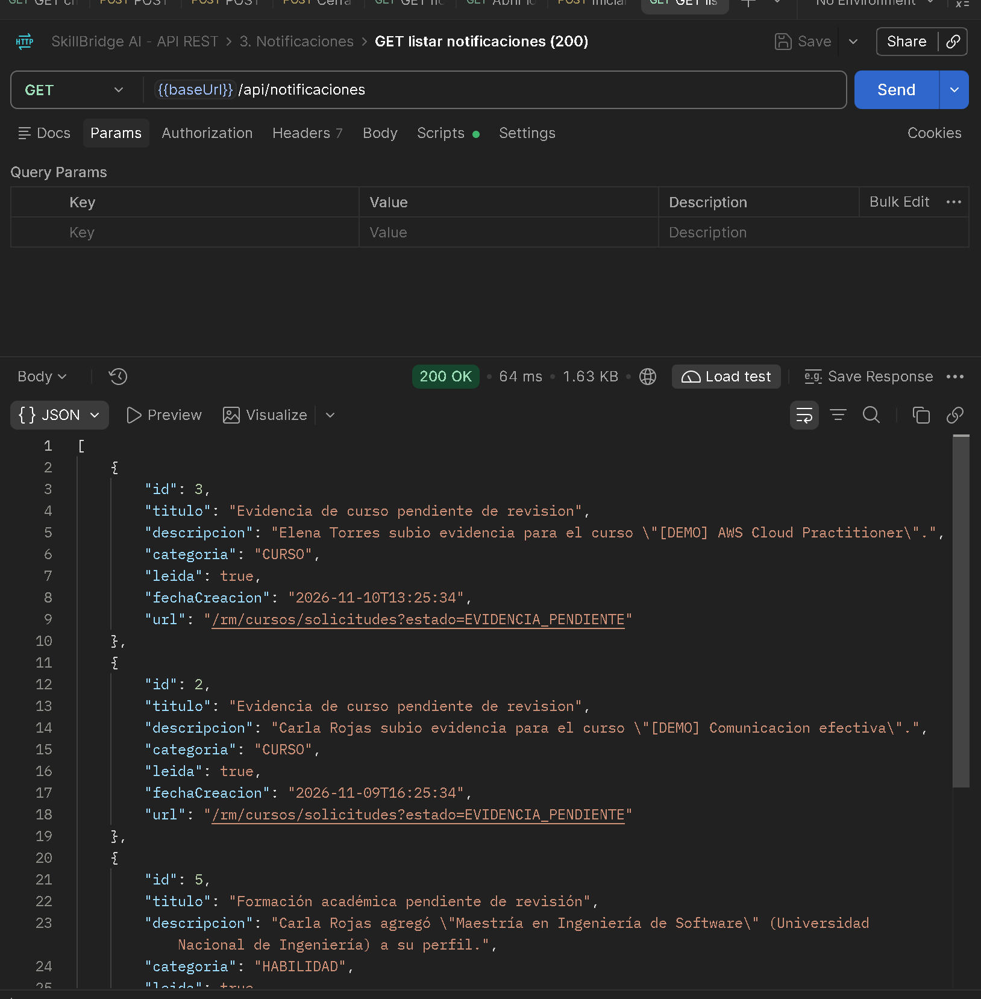 · Solicitud incorrecta (sin sesión): 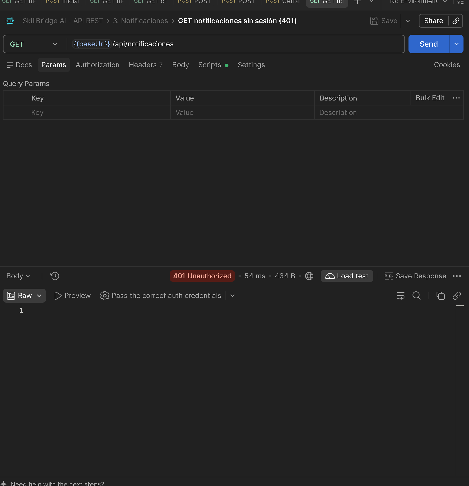

---

### Consumo API REST para marcar una notificación como leída

| URL | Method |
|---|---|
| `http://{servidor}:8080/api/notificaciones/{id}/leer` | POST |

**Autenticación:** sesión con cualquier rol + cabecera `X-CSRF-TOKEN`.

**Argumentos de entrada:**

| Campo | Tipo de dato | Observaciones |
|---|---|---|
| id | entero | En la ruta. Debe ser una notificación del propio usuario |

**Argumentos de salida:**

Opción 1: Solicitud correcta
Http Status: HTTP 204 No Content (sin body).

Opción 2: Error en los parámetros de la solicitud
Http Status: HTTP 400 Bad Request
Body:
```json
{ "error": "No se encontró la notificación." }
```
Se responde igual si la notificación no existe o si es de otro usuario, para no revelar qué ids existen. La
notificación ajena **no** se modifica. Con un id no numérico: `El valor del parámetro "id" no es válido.`

Opción 3: Sin token CSRF: HTTP 403 Forbidden. Sin sesión: HTTP 401 Unauthorized.

**Ejemplos:** Solicitud correcta: 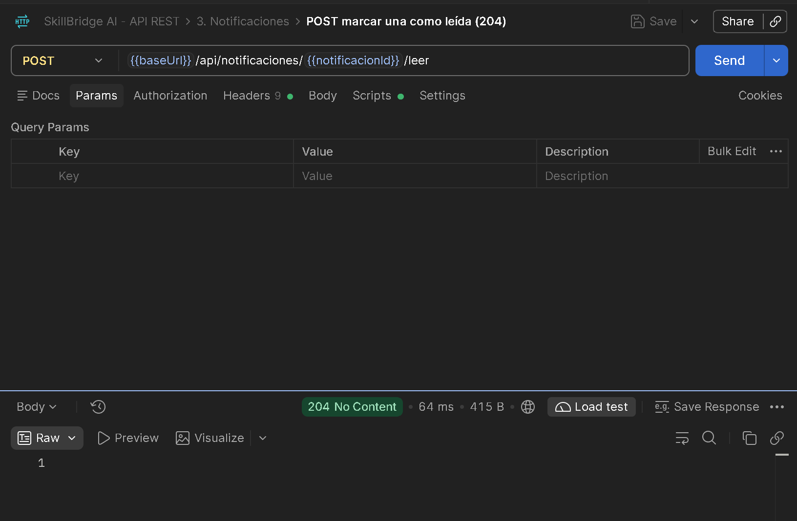 · Solicitud incorrecta: 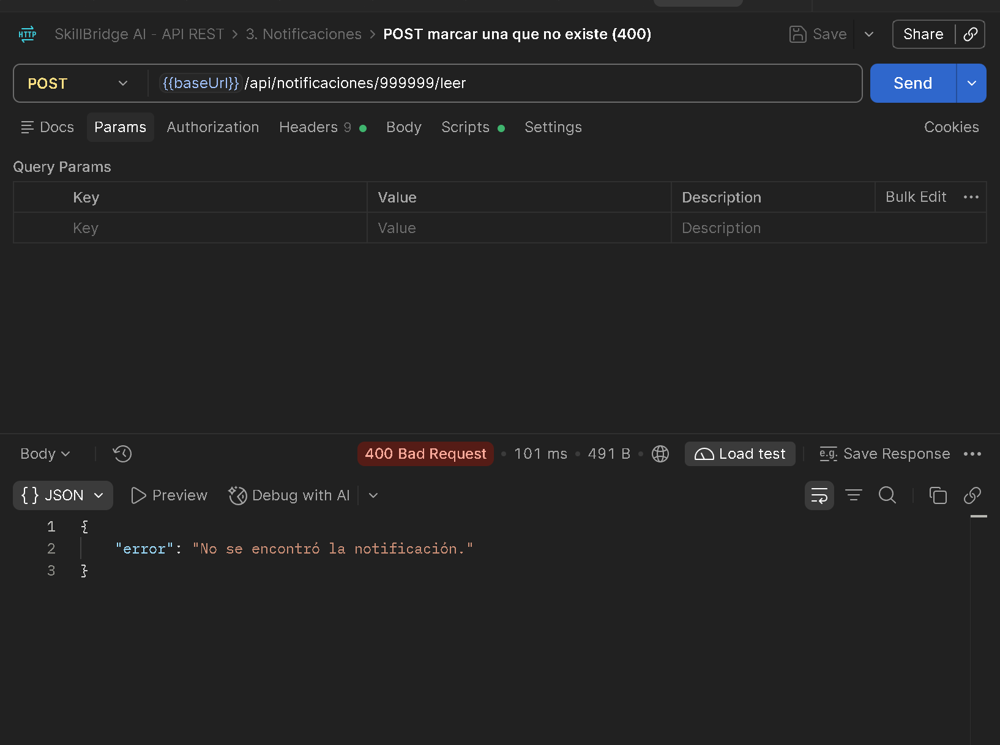

---

### Consumo API REST para marcar todas las notificaciones como leídas

| URL | Method |
|---|---|
| `http://{servidor}:8080/api/notificaciones/leer-todas` | POST |

**Autenticación:** sesión con cualquier rol + cabecera `X-CSRF-TOKEN`.

**Argumentos de entrada:** Ninguno.

**Argumentos de salida:**

Opción 1: Solicitud correcta
Http Status: HTTP 204 No Content (sin body).

Opción 2: Sin token CSRF
Http Status: HTTP 403 Forbidden
Body:
```json
{ "timestamp": "2026-11-10T20:45:53.641Z", "status": 403, "error": "Forbidden", "path": "/api/notificaciones/leer-todas" }
```

**Ejemplos:** Solicitud correcta: 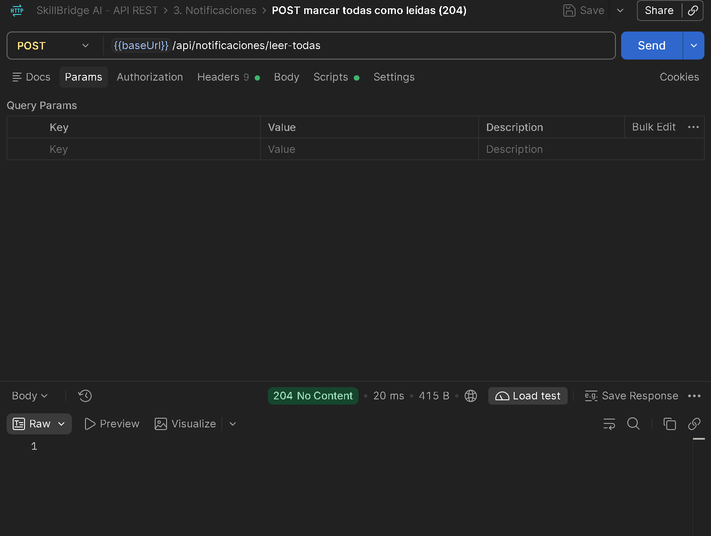 · Solicitud incorrecta (sin CSRF): 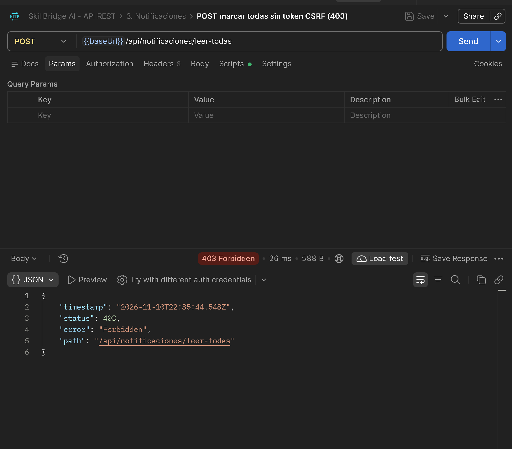

---

## 4.4 WebSocket del chat

El chat usa un WebSocket (STOMP) solo para **avisar** que llegó un mensaje; los mensajes se envían y se leen
siempre por la API REST. Si el WebSocket falla, la vista vuelve a consultar la API cada cierto tiempo.

| Aspecto | Valor |
|---|---|
| Endpoint | `ws://{servidor}:8080/ws-chat` (`WebSocketConfig`) |
| Suscripción permitida | Solo `/user/queue/chat`: cada usuario recibe únicamente sus propios avisos |
| Aviso | `{"proyectoId": 8, "usuarioId": 12}`: en qué proyecto y de qué chat llegó un mensaje |
| Seguridad | Exige sesión iniciada (401 sin ella) y rol PM, Colaborador o RM. No se puede suscribir a otros destinos ni enviar mensajes por el WebSocket |

## 4.5 Correcciones hechas al documentar la API

| Fecha | Problema encontrado | Corrección | Archivo |
|---|---|---|---|
| 10/11/2026 | 5 de los 8 endpoints de entonces respondían sus errores con una redirección (302) en vez de JSON; sin sesión redirigían al login | `@RestControllerAdvice` con errores JSON; 401 en las rutas de API | `ApiErrorAdvice.java`, `SecurityConfig.java` |
| 10/11/2026 | El chat del colaborador no tenía el límite de 1000 caracteres del PM | Mismas reglas en los dos chats | `ColChatService.java` |
| 15/11/2026 | Dos `@RestControllerAdvice` (`ApiErrorAdvice` y `ChatRestExceptionHandler`) atendían los mismos controladores con la misma prioridad | Se unieron en uno solo, con el error inesperado → 500 con log | `ApiErrorAdvice.java` |
| 16/11/2026 | Las acciones del asistente sin `cursoId` o sin `proyectoId` respondían 500 | Validación con mensaje claro (400) | `ColAsistenteService.java` |

Todas tienen pruebas automáticas en `ApiRestTests`.

## 4.6 Colección de Postman

Archivo: [`postman/SkillBridge_API.postman_collection.json`](postman/SkillBridge_API.postman_collection.json)

- 5 carpetas: Chat del PM, Chat del colaborador, Notificaciones, Chat del RM y Asistente del colaborador. Cada
  petición tiene sus tests.
- Cada carpeta abre `/login`, inicia sesión, prueba casos correctos y de error, y cierra sesión. Se incluyen
  casos sin sesión (401), sin CSRF (403) y con rol equivocado (403).
- Un script guarda el token CSRF de cada respuesta HTML en la variable `csrf`.
- Antes de ejecutarla: cambiar `baseUrl` (por defecto `http://localhost:8080`) y escribir la contraseña demo en
  la variable `password`. **No se guarda ninguna contraseña en el archivo.**
- Se ejecuta con *Run collection* y en orden: la carpeta del PM escribe los mensajes que luego leen el
  colaborador y el RM.
- La solicitud de curso del asistente solo da 200 la primera vez; en las siguientes ejecuciones responde 400
  porque la solicitud ya existe. Para repetirla desde cero hay que volver a cargar los datos demo.
