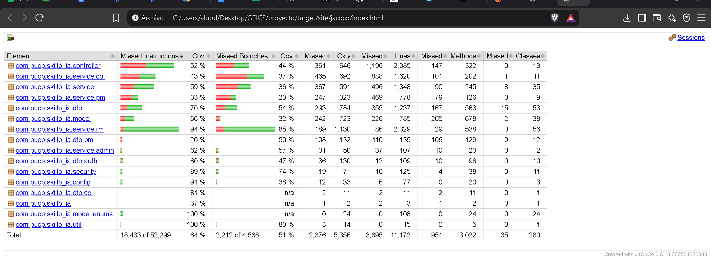
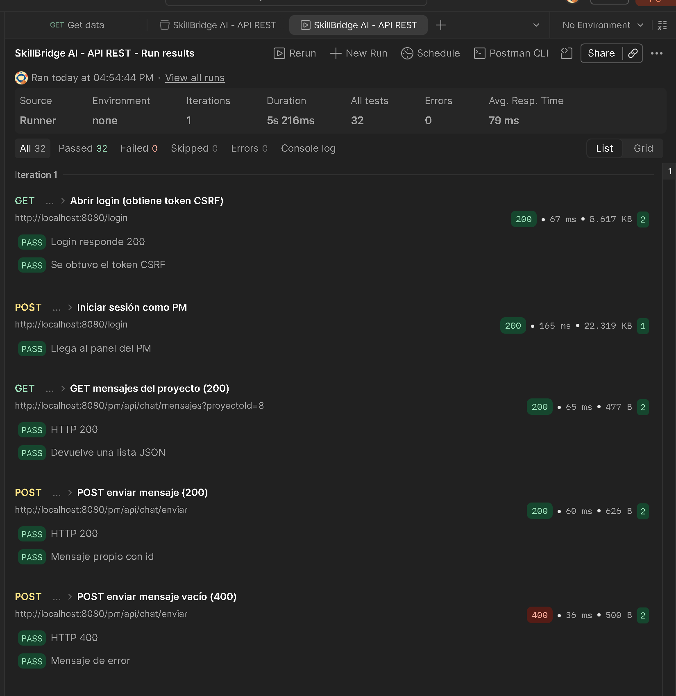

# 7. Resultados del testeo

> Borrador parcial. Ya tiene los resultados reales de `./mvnw clean verify` (10/11/2026, commit `e7b22fb` + plugin JaCoCo +
> corrección de la API REST) y del Runner de Postman. Faltan las fichas de casos (7.2/7.3) y la tabla de bugs (7.5).

## 7.1 Tipos de prueba

| Tipo | Herramienta | Qué cubre | Cantidad | Resultado |
|---|---|---|---|---|
| Automatizadas de integración | JUnit 5 + Spring Boot Test + MockMvc, base H2 en memoria (perfil `test`) | Servicios, controladores, validaciones, seguridad y vistas de los 4 roles | 782 pruebas en 26 clases | 782 aprobadas, 0 fallidas, 0 omitidas |
| Integración continua | GitHub Actions (`.github/workflows/ci.yml`) | Ejecuta `mvnw clean verify` en cada push y pull request | Todas las anteriores | `[pendiente: captura de la pestaña Actions]` |
| API | Postman (`docs/informe/postman/SkillBridge_API.postman_collection.json`) | Los 8 endpoints REST: casos correctos, datos inválidos, sin CSRF, rol equivocado y sin sesión | 26 peticiones, 32 tests | 32 aprobados, 0 fallidos, 0 errores (ver 7.6) |
| Funcionales por rol | Manual | `[pendiente]` | `[ ]` | `[ ]` |
| Seguridad | Manual + `SeguridadTests` | Acceso por rol, CSRF, 403 con auditoría (ver `docs/SEGURIDAD.md`) | 13 automatizadas + `[ ]` manuales | `[ ]` |

Las pruebas son **de integración**: levantan el contexto de Spring y usan la base H2, no simulan las
dependencias con mocks. No tocan MySQL ni la base de desarrollo.

**Pruebas por módulo**

| Módulo | Clases de prueba | Pruebas |
|---|---|---|
| Resource Manager | 14 clases (`Rm*Tests`) | 627 |
| Project Manager | `PmSolicitudPersonalTests`, `PmProyectoCancelacionTests` | 34 |
| Administrador | `AdminPerfilYCatalogosTests`, `AdminCargoTests` | 32 |
| Pre-registro del colaborador (Admin + Colaborador) | `PreRegistroColaboradorTests` | 30 |
| Colaborador | `ColaboradorCursoEvidenciaTests`, `ColaboradorCursoSolicitudTests` | 26 |
| Autenticación y seguridad | `SeguridadTests`, `FormulariosAuthValidacionTests` | 17 |
| Correo, foro del colaborador, notificaciones y paginación | `MejorasCorreoForoPaginacionTests` | 7 |
| API REST (errores en JSON, 401 sin sesión, reglas del chat) | `ApiRestTests` | 8 |
| Arranque de la aplicación | `SkillbIaApplicationTests` | 1 |
| **Total** | **26 clases** | **782** |

## 7.4 Cobertura

```
Comando:  ./mvnw clean verify          (Windows: .\mvnw.cmd clean verify)
Reporte:  target/site/jacoco/index.html
Fecha:    10/11/2026
```

| Métrica | Cobertura |
|---|---|
| **Líneas** | **65.1 %** |
| Instrucciones | 64.8 % |
| Ramas (if/else, switch) | 51.6 % |



**Cobertura de líneas por paquete**

| Paquete | Líneas | Cobertura |
|---|---|---|
| `util` | 15 | 100.0 % |
| `model.enums` | 108 | 100.0 % |
| `service.rm` | 2329 | 96.3 % |
| `config` | 77 | 92.2 % |
| `security` | 126 | 92.1 % |
| `dto.auth` | 109 | 89.0 % |
| `dto.col` | 11 | 81.8 % |
| `dto` | 1237 | 71.3 % |
| `model` | 785 | 71.2 % |
| `service.admin` | 107 | 65.4 % |
| `service` | 1348 | 63.2 % |
| `controller` | 2385 | 49.9 % |
| `service.col` | 1620 | 45.2 % |
| `service.pm` | 778 | 39.7 % |
| `dto.pm` | 135 | 18.5 % |

**Lectura de los resultados**

- El módulo del RM es el mejor cubierto (96 % de sus servicios) porque concentra 627 de las 782 pruebas.
- Los módulos del **colaborador** (45 %) y del **PM** (40 %) son los menos cubiertos. Las clases grandes con menos
  cobertura son `ColaboradorForoService` (6 %), `PmActividadService` (6 %), `PmForoService` (8 %),
  `ColaboradorProyectoService` (10 %) y los controladores `ColaboradorViewController` (17 %),
  `PmViewController` (22 %) y `AdminViewController` (22 %).
- Para subir la cobertura convendría agregar pruebas a esas clases, empezando por foros y actividades.

## 7.6 Pruebas de la API con Postman

```
Colección: docs/informe/postman/SkillBridge_API.postman_collection.json
Ejecución: Postman Runner, 1 iteración, contra http://localhost:8080 con los datos demo
Fecha:     10/11/2026, 04:54 p. m.
```

| Peticiones | Tests | Aprobados | Fallidos | Errores | Duración | Tiempo promedio de respuesta |
|---|---|---|---|---|---|---|
| 26 | 32 | 32 | 0 | 0 | 5 s 216 ms | 79 ms |

| Carpeta | Casos probados | Códigos obtenidos |
|---|---|---|
| 1. Chat del PM | Listar y enviar mensajes; mensaje vacío; proyecto de otro PM; sin token CSRF; sin `proyectoId`; sin sesión | 200, 200, 400, 400, 403, 400, 401 |
| 2. Chat del colaborador | Listar y enviar mensajes; proyecto donde no está asignado; chat del PM con rol colaborador | 200, 200, 400, 403 |
| 3. Notificaciones | Sin sesión; listar; marcar una; marcar una inexistente; marcar todas; marcar todas sin CSRF | 401, 200, 204, 400, 204, 403 |

Los pasos de abrir el login, iniciar sesión y cerrar sesión de cada carpeta preparan la sesión y el token CSRF;
algunos no tienen tests propios ("No tests found" en el reporte).


