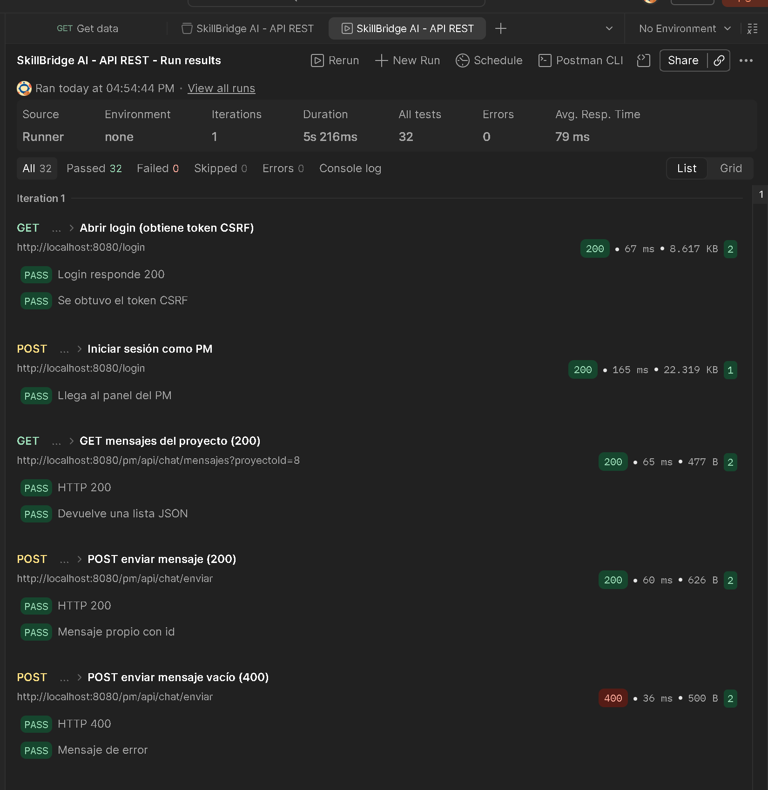

# 7. Resultados del testeo

> Borrador parcial. Tiene los resultados reales de `./mvnw clean verify` del 16/11/2026, con el chat nuevo, el
> asistente IA y el reparto entre RM ya integrados. La ejecución anterior (10/11/2026) queda como referencia en
> 7.4. Faltan las fichas de casos (7.2/7.3), la tabla de bugs (7.5) y volver a correr el Runner de Postman con la
> colección ampliada (7.6).

## 7.1 Tipos de prueba

| Tipo | Herramienta | Qué cubre | Cantidad | Resultado |
|---|---|---|---|---|
| Automatizadas de integración | JUnit 5 + Spring Boot Test + MockMvc, base H2 en memoria (perfil `test`) | Servicios, controladores, validaciones, seguridad y vistas de los 4 roles | 787 pruebas en 27 clases | 787 aprobadas, 0 fallidas, 0 omitidas |
| Integración continua | GitHub Actions (`.github/workflows/ci.yml`) | Ejecuta `mvnw clean verify` en cada push y pull request | Todas las anteriores | `[pendiente: captura de la pestaña Actions]` |
| API | Postman (`docs/informe/postman/SkillBridge_API.postman_collection.json`) | Los 19 endpoints REST: casos correctos, datos inválidos, JSON mal formado, sin CSRF, rol equivocado y sin sesión | 63 peticiones | `[pendiente: volver a correr el Runner]` (ver 7.6) |
| Funcionales por rol | Manual | `[pendiente]` | `[ ]` | `[ ]` |
| Seguridad | Manual + `SeguridadTests` | Acceso por rol, CSRF, 403 con auditoría (ver `docs/SEGURIDAD.md`) | 13 automatizadas + `[ ]` manuales | `[ ]` |

Casi todas las pruebas son **de integración**: levantan el contexto de Spring y usan la base H2, no simulan las
dependencias con mocks. No tocan MySQL ni la base de desarrollo. `RmAlcanceTests` es una prueba unitaria pura
(sin Spring).

**Pruebas por módulo**

| Módulo | Clases de prueba | Pruebas |
|---|---|---|
| Resource Manager | 15 clases (`Rm*Tests`) | 631 |
| Project Manager | `PmSolicitudPersonalTests`, `PmProyectoCancelacionTests` | 34 |
| Administrador | `AdminPerfilYCatalogosTests`, `AdminCargoTests` | 32 |
| Pre-registro del colaborador (Admin + Colaborador) | `PreRegistroColaboradorTests` | 30 |
| Colaborador | `ColaboradorCursoEvidenciaTests`, `ColaboradorCursoSolicitudTests` | 26 |
| Autenticación y seguridad | `SeguridadTests`, `FormulariosAuthValidacionTests` | 17 |
| API REST (errores en JSON, 401 sin sesión, reglas del chat, acciones del asistente) | `ApiRestTests` | 9 |
| Correo, foro del colaborador, notificaciones y paginación | `MejorasCorreoForoPaginacionTests` | 7 |
| Arranque de la aplicación | `SkillbIaApplicationTests` | 1 |
| **Total** | **27 clases** | **787** |

## 7.4 Cobertura

```
Comando:  ./mvnw clean verify          (Windows: .\mvnw.cmd clean verify)
Reporte:  target/site/jacoco/index.html
Fecha:    16/11/2026
```

| Métrica | 16/11/2026 | 10/11/2026 |
|---|---|---|
| **Líneas** | **61.1 %** | 65.1 % |
| Instrucciones | 60.1 % | 64.8 % |
| Ramas (if/else, switch) | 46.4 % | 51.6 % |

`[pendiente: nueva captura de target/site/jacoco/index.html; la de capturas/jacoco.png es del 10/11]`

La cobertura bajó porque entre el 11 y el 12/11 se agregó código nuevo (asistente IA, chat privado y chat del
RM) con pocas pruebas propias: el número de pruebas casi no cambió y las líneas del proyecto aumentaron.

**Cobertura de líneas por paquete (16/11/2026)**

| Paquete | Líneas | Cobertura |
|---|---|---|
| `util` | 15 | 100.0 % |
| `model.enums` | 108 | 100.0 % |
| `security` | 126 | 92.1 % |
| `service.rm` | 2626 | 91.7 % |
| `dto.auth` | 109 | 89.0 % |
| `config` | 95 | 84.2 % |
| `dto.col` | 11 | 81.8 % |
| `model` | 793 | 71.4 % |
| `dto` | 1257 | 70.4 % |
| `service.admin` | 107 | 65.4 % |
| `service` | 1526 | 61.7 % |
| `controller` | 2476 | 49.2 % |
| `service.pm` | 803 | 38.4 % |
| `service.col` | 2302 | 34.2 % |
| `dto.pm` | 135 | 18.5 % |

**Lectura de los resultados**

- El módulo del RM sigue siendo el mejor cubierto (92 % de sus servicios), con 631 de las 787 pruebas.
- Los módulos del **colaborador** (34 %) y del **PM** (38 %) son los menos cubiertos. Las clases grandes con menos
  cobertura son las del asistente IA (`ColAsistenteContextoService` 5 %, `ColAsistenteService` 11 %,
  `ColAsistenteIaClient` 18 %), los foros (`ColaboradorForoService` 6 %, `PmForoService` 8 %),
  `PmActividadService` (6 %), `ColaboradorProyectoService` (10 %) y los controladores `ColaboradorViewController`
  (17 %) y `PmViewController` (22 %).
- Para subir la cobertura convendría agregar pruebas a esas clases, empezando por el asistente, los foros y las
  actividades.

## 7.6 Pruebas de la API con Postman

**Ejecución del 10/11/2026 (colección con los 7 primeros endpoints)**

```
Colección: docs/informe/postman/SkillBridge_API.postman_collection.json (versión de 26 peticiones)
Ejecución: Postman Runner, 1 iteración, contra http://localhost:8080 con los datos demo
Fecha:     10/11/2026, 04:54 p. m.
```

| Peticiones | Tests | Aprobados | Fallidos | Errores | Duración | Tiempo promedio de respuesta |
|---|---|---|---|---|---|---|
| 26 | 32 | 32 | 0 | 0 | 5 s 216 ms | 79 ms |



**Colección ampliada (16/11/2026)**: 63 peticiones en 5 carpetas. Todos sus casos se verificaron con `curl`
contra la aplicación local; falta ejecutarla en el Runner y reemplazar la captura.

| Carpeta | Casos probados |
|---|---|
| 1. Chat del PM | Mensajes y envío grupal; contactos; no leídos; mensaje privado a un colaborador y al RM; mensaje vacío; proyecto de otro PM; colaborador no activo; `proyectoId` faltante o inválido; sin CSRF; sin sesión |
| 2. Chat del colaborador | Mensajes y envío grupal; contactos; no leídos; mensaje privado a un compañero; mensaje privado al RM (no permitido); proyecto sin asignación; sin proyecto; chat del PM y del RM con rol colaborador |
| 3. Notificaciones | Sin sesión; listar; marcar una; marcar una inexistente; marcar todas; marcar todas sin CSRF |
| 4. Chat del RM | No leídos por proyecto; mensajes con el PM; proyecto ajeno; enviar; mensaje vacío |
| 5. Asistente del colaborador | Sin sesión; consulta; consulta vacía; JSON mal formado; historial; limpiar con y sin CSRF; solicitar curso, repetido y sin `cursoId`; postularse a un proyecto donde ya está y sin `proyectoId` |

Los pasos de abrir el login, iniciar sesión y cerrar sesión de cada carpeta preparan la sesión y el token CSRF;
algunos no tienen tests propios ("No tests found" en el reporte).

`[pendiente: resultado y captura del Runner con las 63 peticiones]`
